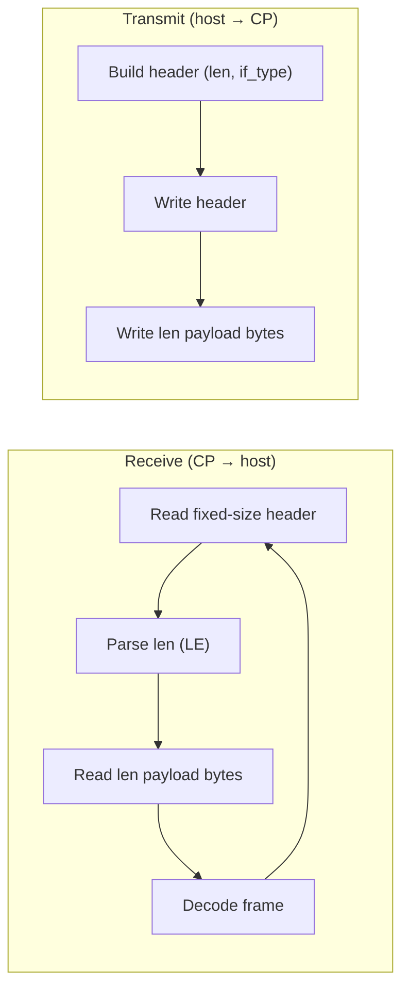
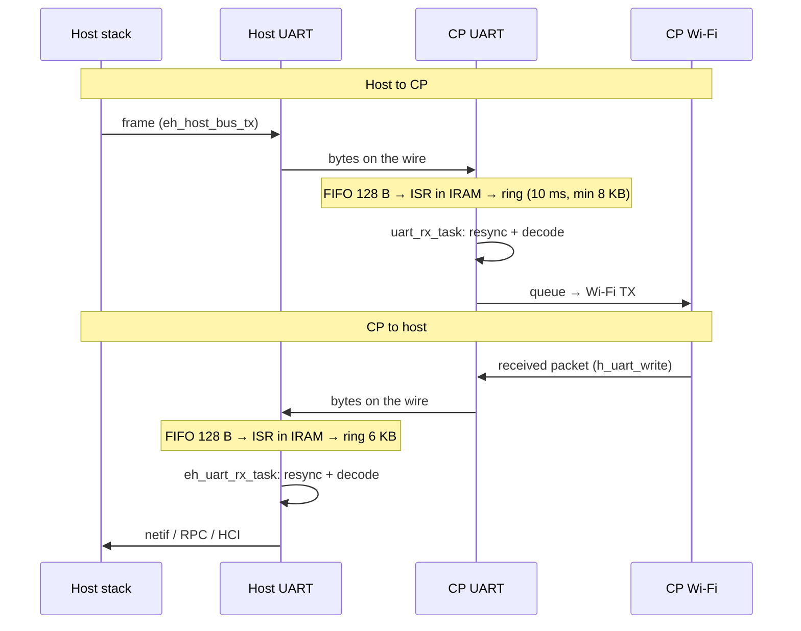
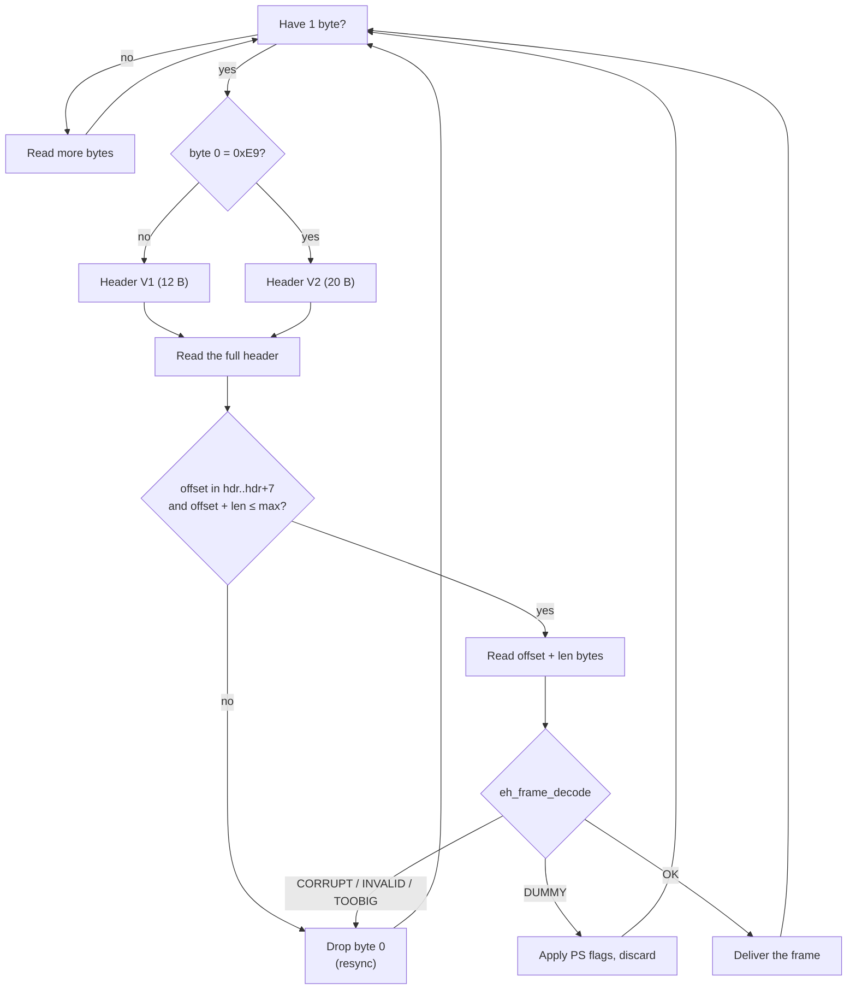
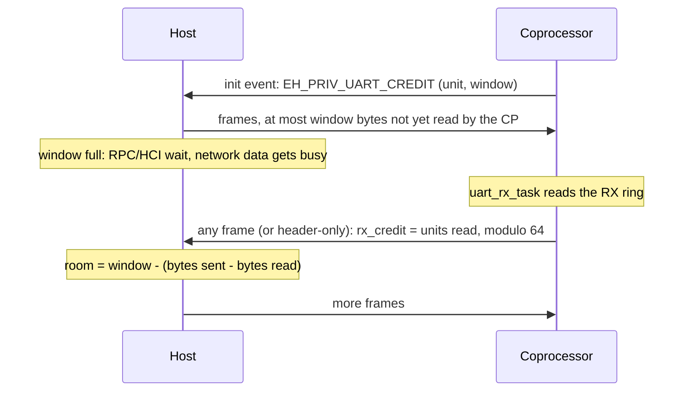

# UART Design

[Home](../../README.md) · [Getting Started: Linux](../getting-started-linux.md) · [Getting Started: MCU](../getting-started-mcu.md) · [Troubleshooting](../troubleshooting.md)

UART is the lowest-wiring-complexity ESP-Hosted transport. This page covers the wire-level protocol; for pin maps, OS configuration, and the verify step, see [Getting Started: MCU](../getting-started-mcu.md#4-uart) (on Linux, UART carries Bluetooth only — see the `+ UART` set-ups in [Getting Started: Linux](../getting-started-linux.md)).

---

## How the protocol works

UART uses a byte stream without handshake or data-ready GPIOs. Both directions use the same length-prefixed framing: the receiver reads a fixed-size header, parses the little-endian `len` field, reads exactly `len` payload bytes, and decodes the frame. The sender writes the header (including `len` and `if_type`) followed by the payload.

The `if_type` field multiplexes Wi-Fi and Bluetooth over the same link. Bluetooth uses Hosted HCI, not standard UART-HCI. During the handshake, the host and coprocessor negotiate base and extended capabilities, including *WLAN over UART*.

Use the default baud rate initially, then evaluate higher baud rates. Kconfig accepts up to 8 Mbaud. Rates above 5 Mbaud are outside the SoC specification; see [Timing budget](#timing-budget) for the tested rates. The baud rate must match on both the host and coprocessor. See [Performance Tuning](performance.md#12-esp32-c5-as-co-processor).

> [!NOTE]
> The framing has no delimiter or escaping. If a byte is lost, the receiver skips to the next byte that can start a header and checks the frame checksum. Header-only frames are checked too. Exception: a header-only frame with power-save flags and a zero checksum field passes on the offset checks alone, because the host can send its wake frame before it knows that checksums are on. The frames around the lost byte are lost, but the link stays up. The link has no hardware flow control, so use clean wiring.

Code: `coprocessor/eh_cp_transport/src/eh_cp_transport_uart.c`, `host/mcu/eh_host_mcu_transport/src/eh_host_bus_uart.c`, `common/eh_frame/`. See [Architecture & Protocol](../architecture.md#3-on-wire-frame-format) for the frame header and handshake.

---

## Low-level design

### Data path

### Receive and resync (both ends)

The receiver keeps the bytes of the next frame in a buffer. A header that cannot be valid moves the search one byte forward. The link does not stop.

Both ends make these checks. On `UART_FIFO_OVF`, the host keeps its buffer. The resync drops only the damaged frame.

The CP sets the checksum (`CONFIG_EH_TRANSPORT_CP_UART_CHECKSUM`, default on) and tells the host in the init event. Host frames sent before the init event have no checksum. Without a checksum, the receiver depends on the offset and length checks. These checks find most false headers, but not all of them.

### Where data can be lost

| Point | Cause | Signal | Result |
| :--- | :--- | :--- | :--- |
| HW RX FIFO (128 B) | ISR too late | `uart evt: fifo_ovf` (CP), `fifo_ovf[]` (host packet stats) | Bytes lost; resync |
| Driver RX ring | RX task too slow | `uart evt: buf_full` (CP) | Bytes lost; resync |
| CP Wi-Fi TX | Wi-Fi TX full for 16 retries | `STA: ... H2S(... fail[])` (CP packet stats) | Frame dropped by Wi-Fi |
| Host frame without credit | Network data, or a frame from the host UART RX task | busy error to the stack (`ERR_BUF` for network data) | Frame dropped or repeated by the stack |

Neither end writes console output from the RX path. One line on a 115200 console takes about 5 ms, and the ring can overflow in that time. Other tasks print the counters: on the CP, `uart_evt_task` and `flow_ctrl_task` (`uart rx: dropped frames`, at most once per second) at warning level; on the host, the packet stats (`CONFIG_ESP_HOSTED_HOST_PKT_STATS`).

### Flow control

The link has no hardware flow control. The host uses byte credit: it never has more unread bytes at the CP than the CP RX ring can hold. Byte credit is used only on UART. With the default configuration (`CONFIG_ESP_CACHE_MALLOC=y`), the transport waits for buffers and credit instead of dropping a frame. Bytes can still be lost in the hardware FIFO (see the table above).

- In its init event, the CP sends `EH_PRIV_UART_CREDIT`: the credit unit (ring / 32) and the window (ring minus one unit), in bytes.
- Each frame from the CP carries `rx_credit`: the bytes that `uart_rx_task` has read from the RX ring, in units, modulo 64. V1 has it in byte 10, bits 2 to 7. V2 has it in byte 15.
- When the CP has no frame to send, a header-only frame carries the credit. The CP sends one after 8 units, and every 20 ms for 500 ms after the last read.
- The host counts every byte that it writes. It sends a frame only if the bytes not yet read by the CP, plus the frame, fit in the window.
- Without credit, RPC, raw TP and HCI frames wait.
- Without credit, network data and frames from the host UART RX task get a busy error. lwIP sends them with its core lock held, and the RX task needs that lock to keep reading. For network data, the host sets the Wi-Fi TX throttle (`ERR_BUF` to lwIP) until the window has room for one frame.
- If the window has no room and the credit does not change for 200 ms, the host assumes that bytes were lost on the line. It resets the window (credit reset) and counts the event.
- A header-only frame with credit 0 is told from a dummy frame by its checksum. With the CP checksum off, the host misses that credit and waits for the next one, or for the credit reset.
- An older CP sends no credit TLV, so the host does not use credit. An older host ignores `rx_credit`.

On the CP:

- If the RX pool is empty, `uart_rx_task` waits for a free buffer. The bytes wait in the driver ring.
- If Wi-Fi TX is full, `wifi_tx_with_retry()` retries up to `CONFIG_ESP_HOSTED_CP_WIFI_TX_RETRY_LIMIT` times, 1 ms apart (default 16). Then Wi-Fi drops the frame. The host does not send more than the window meanwhile, so the ring does not overflow.

### Timing budget

8N1 sends 10 bits per byte.

| Baud | ISR headroom at IRQ 64 B | at IDF default (~120 B) | CP ring | Host ring | 8N1 ceiling (Mbit/s) |
| ---: | ---: | ---: | ---: | ---: | ---: |
| 921600 | 694 µs | 87 µs | 8192 B (89 ms) | 6144 B (67 ms) | 0.74 |
| 8 Mbaud | 80 µs | 10 µs | 8192 B (10 ms) | 6144 B (7.7 ms) | 6.4 |

The ISR must start within the headroom, or the FIFO overflows. While flash operations run, an ISR in flash cannot start. For this reason, both ends select `CONFIG_UART_ISR_IN_IRAM`.

Code that runs with interrupts disabled delays the ISR. For this reason the range stops at 8 Mbaud. Tested:

- ESP32-P4 + ESP32-C5 core board, before byte credit: iperf from the CP to the host lost one frame in 1 of 20 runs at 10 Mbaud (64 µs) and in about 1 of 4 runs at 16 Mbaud (40 µs). A higher interrupt level did not help.
- ESP32-P4X + ESP32-C5 Function EV board, with byte credit: raw throughput both ways at once, TCP and UDP both ways, 921600 to 16 Mbaud: no frame lost. At 20 Mbaud a raw throughput run lost 9 frames (CP RX FIFO overflow).

### Configuration

| Item | Host | Coprocessor |
| :--- | :--- | :--- |
| Baud | `CONFIG_ESP_HOSTED_HOST_UART_BAUD` | `CONFIG_EH_TRANSPORT_CP_UART_BAUDRATE` |
| Range | 9600 – 8000000 (above 5000000 is outside the SoC specification) | same |
| ISR in IRAM | selected by `ESP_HOSTED_HOST_TRANSPORT_BUS_UART` | selected by `EH_TRANSPORT_CP_UART` |
| FIFO IRQ threshold | 64 B (`EH_UART_RX_FULL_THRESH`) | 64 B (`UART_RX_FULL_THRESH`) |
| Driver RX ring | 6144 B (`EH_UART_RX_BUF_SIZE`) | 10 ms of line time, at least 8192 B (`UART_RX_RING_SIZE`) |
| RX queue / pool | – | `CONFIG_EH_TRANSPORT_CP_UART_RX_Q_SIZE` (default 5) |
| HW flow control | off | off |

---

## See also

- [Architecture & Protocol](../architecture.md) — shared framing, queues, and the capability handshake.
- [Bluetooth Design](bluetooth.md) — Hosted-HCI vs standard UART-HCI for Bluetooth.
- Wiring & bring-up: [Getting Started: MCU](../getting-started-mcu.md#4-uart).
