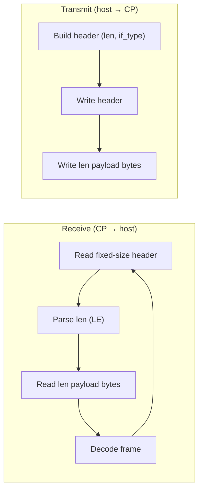
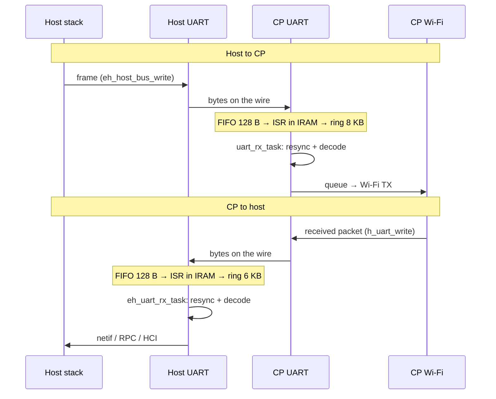
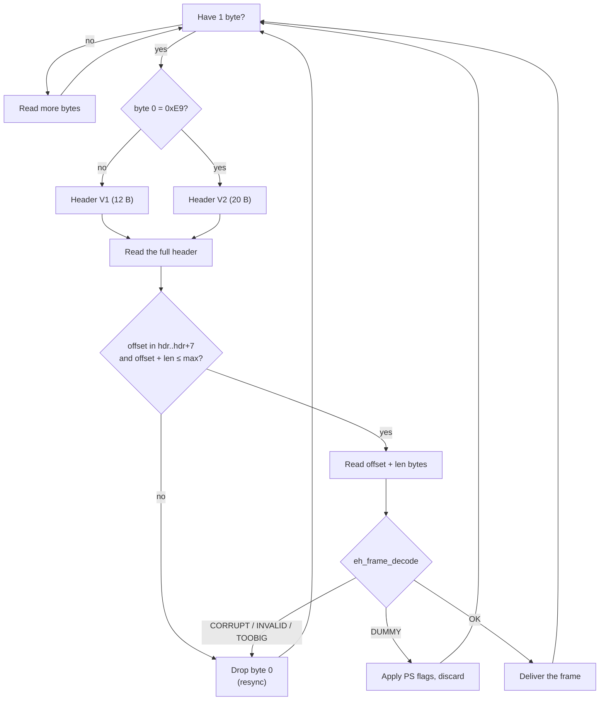

# UART Design

[Home](../../README.md) · [Getting Started: Linux](../getting-started-linux.md) · [Getting Started: MCU](../getting-started-mcu.md) · [Troubleshooting](../troubleshooting.md)

UART is the lowest-wiring-complexity ESP-Hosted transport. This page covers the wire-level protocol; for pin maps, OS configuration, and the verify step, see [Getting Started: MCU](../getting-started-mcu.md#4-uart) (on Linux, UART carries Bluetooth only — see the `+ UART` set-ups in [Getting Started: Linux](../getting-started-linux.md)).

---

## How the protocol works

UART uses a byte stream without handshake or data-ready GPIOs. Both directions use the same length-prefixed framing: the receiver reads a fixed-size header, parses the little-endian `len` field, reads exactly `len` payload bytes, and decodes the frame. The sender writes the header (including `len` and `if_type`) followed by the payload.

The `if_type` field multiplexes Wi-Fi and Bluetooth over the same link. Bluetooth uses Hosted HCI, not standard UART-HCI. During the handshake, the host and coprocessor negotiate base and extended capabilities, including *WLAN over UART*.

Use the default baud rate initially, then evaluate increasing baud rates up to 8 Mbaud. The baud rate must match on both the host and coprocessor. See [Performance Tuning](performance.md#12-esp32-c5-as-co-processor).

> [!NOTE]
> The framing has no delimiter or escaping. If a byte is lost, the receiver skips to the next byte that can start a header and checks the frame checksum. Header-only frames are checked too, so payload bytes cannot set power-save flags. The frames around the lost byte are lost, but the link stays up. The link has no hardware flow control, so use clean wiring.

Code: `coprocessor/eh_cp_transport/src/eh_cp_transport_uart.c`, `host/mcu/eh_host_mcu_transport/src/eh_host_bus_uart.c`, `common/eh_frame/`. See [Architecture & Protocol](../architecture.md#3-on-wire-frame-format) for the frame header and handshake.

---

## Low-level design

### Data path

### Receive and resync (both ends)

The receiver keeps the bytes of the next frame in a buffer. A header that cannot be valid moves the search one byte forward. The link does not stop.

Both ends make these checks. On `UART_FIFO_OVF`, the host keeps its buffer. The resync drops only the damaged frame.

The host does not send a checksum (`checksum_enabled = 0`). Without a checksum, the CP depends on the offset and length checks. These checks find most false headers, but not all of them.

### Where data can be lost

| Point | Cause | Signal | Result |
| :--- | :--- | :--- | :--- |
| HW RX FIFO (128 B) | ISR too late | `uart evt: fifo_ovf` (CP), `RX FIFO overflow` (host, debug level) | Bytes lost; resync |
| Driver RX ring | RX task too slow | `uart evt: buf_full` (CP) | Bytes lost; resync |
| CP Wi-Fi TX | Wi-Fi TX full for 16 retries | `STA: ... H2S(... fail[])` (CP packet stats) | Frame dropped by Wi-Fi |

Neither end writes console output from the RX path. One line on a 115200 console takes about 5 ms, and the ring can overflow in that time. Other tasks print the counters.

### Backpressure

The link has no hardware flow control. The CP does not send `throttle_cmd`. The transport waits instead of dropping frames:

- Host to CP: if the RX pool is empty, `uart_rx_task` waits for a free buffer. The bytes wait in the driver ring.
- Host to CP: if Wi-Fi TX is full, `wifi_tx_with_retry()` retries for up to 16 ms per frame. The bytes from the host wait in the driver ring.
- CP to host: the CP TX blocks until the line is free.

The host cannot be stopped, so the wait is limited by the CP buffering: the 8 KB ring and the RX pool. If Wi-Fi TX stays full longer, the ring overflows and bytes are lost (`uart evt: buf_full`). Hardware flow control (RTS/CTS) would stop the host instead.

### Timing budget

8N1 sends 10 bits per byte.

| Baud | ISR headroom at IRQ 64 B | at IDF default (~120 B) | CP ring | Host ring | 8N1 ceiling (Mbit/s) |
| ---: | ---: | ---: | ---: | ---: | ---: |
| 921600 | 694 µs | 87 µs | 8192 B (89 ms) | 6144 B (67 ms) | 0.74 |
| 8 Mbaud | 80 µs | 10 µs | 8192 B (10 ms) | 6144 B (7.7 ms) | 6.4 |

The ISR must start within the headroom, or the FIFO overflows. While flash operations run, an ISR in flash cannot start. For this reason, both ends select `CONFIG_UART_ISR_IN_IRAM`.

Code that runs with interrupts disabled delays the ISR. For this reason the range stops at 8 Mbaud. On the ESP32-P4 host, iperf from the CP to the host lost one frame in 1 of 20 runs at 10 Mbaud (64 µs) and in about 1 of 4 runs at 16 Mbaud (40 µs). A higher interrupt level did not help.

### Configuration

| Item | Host | Coprocessor |
| :--- | :--- | :--- |
| Baud | `CONFIG_ESP_HOSTED_HOST_UART_BAUD` | `CONFIG_EH_TRANSPORT_CP_UART_BAUDRATE` |
| Range | 9600 – 8000000 (above 5000000 is outside the SoC specification) | same |
| ISR in IRAM | selected by `ESP_HOSTED_HOST_TRANSPORT_BUS_UART` | selected by `EH_TRANSPORT_CP_UART` |
| FIFO IRQ threshold | 64 B (`EH_UART_RX_FULL_THRESH`) | 64 B (`UART_RX_FULL_THRESH`) |
| Driver RX ring | 6144 B (`EH_UART_RX_BUF_SIZE`) | 8192 B (`UART_RX_RING_SIZE`) |
| RX queue / pool | – | `CONFIG_EH_TRANSPORT_CP_UART_RX_Q_SIZE` (default 5) |
| HW flow control | off | off |

---

## See also

- [Architecture & Protocol](../architecture.md) — shared framing, queues, and the capability handshake.
- [Bluetooth Design](bluetooth.md) — Hosted-HCI vs standard UART-HCI for Bluetooth.
- Wiring & bring-up: [Getting Started: MCU](../getting-started-mcu.md#4-uart).
