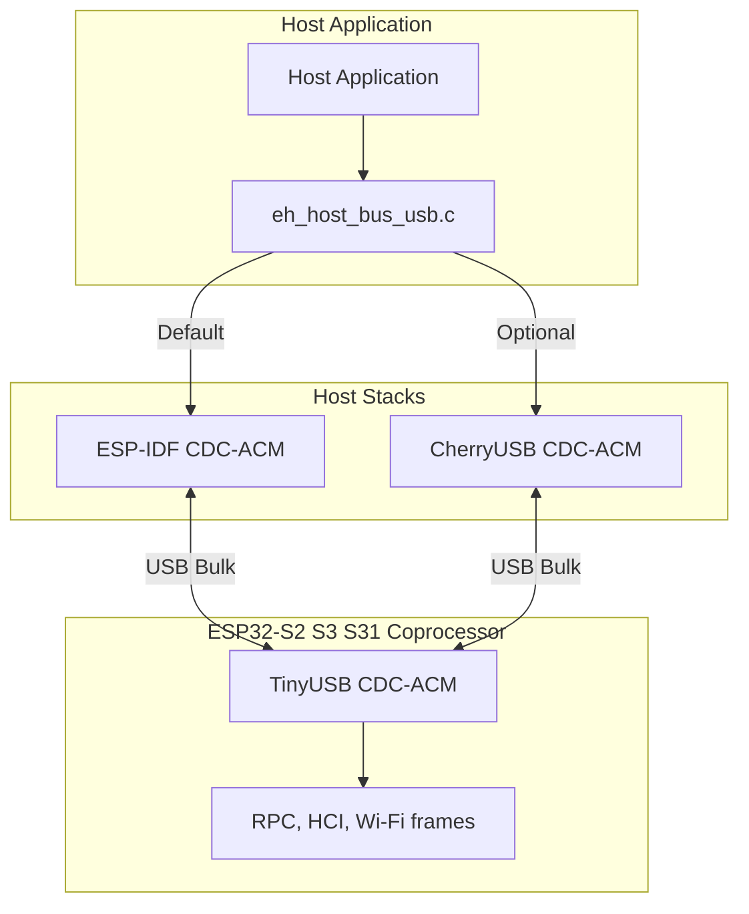
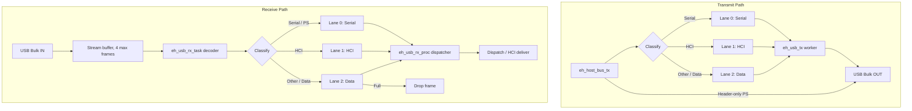
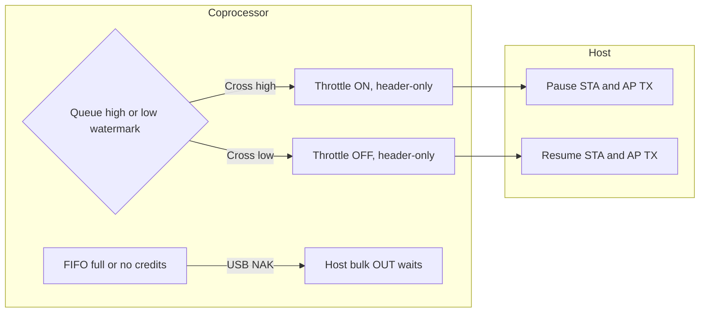

# [Experimental] USB OTG Host Transport (CDC-ACM)

> [!NOTE]
> The USB-OTG interface is currently experimental. Code and configuration is in active development and subject to change.

[Home](../../README.md) · [Getting Started: MCU](../getting-started-mcu.md) · [Architecture](../architecture.md) · [UART Design](uart.md)

The MCU is the USB host. The coprocessor is a USB device. On the CDC-only bus, CDC-ACM carries every ESP-Hosted frame: RPC, HCI, power-save, and STA/AP. With RNDIS, CDC-ACM stays the control pipe and STA/AP Ethernet frames move to RNDIS. See [RNDIS data plane](#rndis-data-plane).

---

## Layers



- Default stack: `ESP_HOSTED_HOST_USB_STACK_CDC_ACM` (`eh_host_bus_usb_cdc_acm.c`, `eh_host_port_usb.c`).
- Optional stack: `ESP_HOSTED_HOST_USB_STACK_CHERRYUSB` (`eh_host_bus_usb_cherryusb.c` only).
- `eh_host_port_usb_deinit()` waits until `usb_host_uninstall()` finishes, so the next init can install the host library again. CherryUSB owns its controller and does not call `usb_host_install()`.

---

## Data path



- Each lane is `ESP_HOSTED_HOST_USB_TX_Q_SIZE` / `ESP_HOSTED_HOST_USB_RX_Q_SIZE` deep (default 20). A zero runtime size uses `EH_HOST_PORT_USB_TX_QUEUE_SIZE` / `EH_HOST_PORT_USB_RX_QUEUE_SIZE`. The byte stream in front of the decoder holds `EH_USB_RX_STREAM_FRAMES` (4) maximum frames.
- Header-only power-save is encoded as `ESP_SERIAL_IF` and written with `s_usb_ops->tx()` under `s_tx_lock`. The call returns after that bulk OUT finishes, so the host does not sleep while `PS_STARTED` is only queued.
- The reader applies throttle ON/OFF before enqueue. A full data lane (`PRIO_Q_OTHERS`) drops the frame with timeout 0 and logs `usb rx data queue full` every 256 drops. Serial and HCI retry for `EH_USB_ENQUEUE_MS` (100 ms) while the bus is running.
- STA and AP use the single buffer from `usb_rx_enqueue()`. `eh_usb_rx_proc` hands it to the channel. HCI, serial, and private frames still go through their existing dispatch path.
- Connect: optional GPIO reset, then open CDC-ACM and assert DTR. The coprocessor starts the data path and sends INIT. A wired reset GPIO may log `HUB: Root port reset failed`; that is expected.
- The ESP-IDF stack opens `ESP_HOSTED_HOST_USB_VID`:`ESP_HOSTED_HOST_USB_PID`. `0` matches any ID. CherryUSB polls `usbh_serial_open("/dev/ttyACM0")` until the connection timeout. CherryUSB needs the CDC notification interrupt endpoint.
- Disconnect posts a transport failure. Framing has no delimiter. See [Architecture](../architecture.md) and [UART Design](uart.md).

---

## Session end and suspend

- After the session has started, a DTR drop or a USB detach runs `esp_restart()` on the coprocessor. The log is `USB disconnect (DTR), resetting` or `USB disconnect (detached), resetting`.
- A DTR fall or detach before the first assert or `SET_CONFIGURATION` does nothing.
- Host power-save bus unload sets `usb_exit_requested` and does not reset.
- USB suspend (SOFs stop) leaves the coprocessor running. The same session continues after resume.
- ESP32-S31 cannot sense VBUS. Pulling the cable looks like suspend, not detach, so neither reset path runs. The chip stays up until a later DTR drop, a real detach, or the reset GPIO.

---

## Backpressure



- Credits: the coprocessor reads CDC only while a credit is free and the stream can hold another frame. Otherwise the device NAKs and the host TX waits.
- Throttle: crossing the high watermark (default 80) sends throttle ON. Crossing the low watermark (default 60) sends throttle OFF. The host then returns `ESP_ERR_ESP_NETIF_NO_MEM` for STA/AP so lwIP backs off. `0` disables the signal. RPC and serial are not throttled.

---

## Configuration

Select the bus with `CONFIG_ESP_HOSTED_HOST_TRANSPORT_BUS_OTG_HOST=y`.

| Symbol | Default | Meaning |
| :--- | :--- | :--- |
| `ESP_HOSTED_HOST_USB_STACK_CDC_ACM` | y | ESP-IDF USB Host Library and `usb_host_cdc_acm` |
| `ESP_HOSTED_HOST_USB_STACK_CHERRYUSB` | n | CherryUSB DWC2 host and its CDC-ACM driver |
| `ESP_HOSTED_HOST_RESET_GPIO` | `-1` | Coprocessor reset GPIO. `-1` skips the pulse |
| `ESP_HOSTED_HOST_USB_CONNECTION_TIMEOUT_MS` | 5000 | Wait for CDC enumeration |
| `ESP_HOSTED_HOST_USB_TX_Q_SIZE` | 20 | Depth of each CDC TX lane. Zero at runtime uses `EH_HOST_PORT_USB_TX_QUEUE_SIZE` |
| `ESP_HOSTED_HOST_USB_RX_Q_SIZE` | 20 | Depth of each CDC RX lane. Zero at runtime uses `EH_HOST_PORT_USB_RX_QUEUE_SIZE` |
| `ESP_HOSTED_HOST_USB_OUT_BUF_SIZE` | 2048 | Bulk OUT size |
| `ESP_HOSTED_HOST_USB_IN_BUF_SIZE` | 0 | Bulk IN size. 0 uses the endpoint MPS |
| `ESP_HOSTED_HOST_DEFLT_TASK_STACK_BYTES` | 4096 | Stack of `eh_usb_rx`, `eh_usb_rx_proc`, `eh_usb_tx`, and the CherryUSB pump |
| `ESP_HOSTED_HOST_DEFLT_TASK_PRIORITY` | 22 | Priority of `eh_usb_rx`, `eh_usb_rx_proc`, `eh_usb_tx`, and the CherryUSB pump |

> [!NOTE]
> When `ESP_HOSTED_HOST_RESET_GPIO` is enabled, the host log may display `HUB: Root port reset failed` during connection. This is expected because the coprocessor is being reset.

---

## RNDIS data plane

Enable it on both ends: `CONFIG_EH_TRANSPORT_CP_USB_OTG_DEVICE_RNDIS` on the co-processor and `CONFIG_ESP_HOSTED_HOST_USB_RNDIS` on the host. The host option is ESP32-P4 with `usb_host_cdc_acm` only. CherryUSB does not carry this data plane.

CDC-ACM stays the control pipe: RPC, serial, HCI, power-save, and flow control. One RNDIS function carries the active STA or SoftAP Ethernet frames. The composite device is VID `0x303A`, PID `0x4081`. [STA and SoftAP routing](#sta-and-softap-routing) describes which interface receives each frame.

### STA and SoftAP routing

RNDIS stays standard Ethernet, so the pipe carries one interface. A mode switch does not re-enumerate USB. CDC-ACM remains the control pipe.

The host records the route in `eh_host_wifi_set_mode()` before it sends the mode RPC, and restores the previous route if that RPC fails. Until the first successful set, every frame is STA. The co-processor classifies each received frame on the RNDIS receive worker by calling `esp_wifi_get_mode()`.

| Mode | Frames go to |
| :--- | :--- |
| `WIFI_MODE_STA`, `WIFI_MODE_NULL` | STA |
| `WIFI_MODE_AP` | SoftAP |

A host `esp_wifi_set_mode(WIFI_MODE_APSTA)` returns `ESP_ERR_INVALID_ARG` and leaves the current mode unchanged. STA and SoftAP cannot share one standard RNDIS function.

| Symbol | Default | Meaning |
| :--- | :--- | :--- |
| `ESP_HOSTED_HOST_USB_RNDIS_TX_Q_SIZE` | 20 | Ethernet frames accepted from lwIP while the bulk OUT worker is busy. A full queue waits until a slot is free |
| `ESP_HOSTED_HOST_USB_RNDIS_RX_Q_SIZE` | 20 | Frames queued from the USB client task while `eh_rndis_rx` dispatches. A full queue dispatches that frame inline |

Example overlays: `examples/wifi/iperf/cp/sdkconfig.defaults.esp32s31.usb_rndis` and `examples/wifi/iperf/mcu_host/sdkconfig.defaults.esp32p4.usb_rndis`. The api_exerciser copies match.

### Settings ESP-Hosted cannot select

These symbols belong to TinyUSB and to the USB host components that `iot_usbh_rndis` uses. A saved sdkconfig keeps the component default, and the build then fails.

On the co-processor, under Component config → TinyUSB Stack → Network driver (ECM/NCM/RNDIS) → Network mode:

- Set **ECM/RNDIS** (`CONFIG_TINYUSB_NET_MODE_ECM_RNDIS=y`). The stock default is None.
- Leave MSC, MTP, Vendor, and NCM off, and keep a single CDC interface. The ESP-Hosted descriptor indexes the TinyUSB string table directly, and the stock TinyUSB configuration descriptor emits NCM.

`iot_usbh_rndis` on the host reads the supported-OID list through the CDC control pipe. Its own menu, IoT USB Host RNDIS, stays at the default (CDC notification enabled). Set both control-transfer sizes to 2048:

- Component config → IoT USB Host CDC → usbh CDC control transfer size (`CONFIG_USBH_CDC_CONTROL_TRANSFER_BUFFER_SIZE`). Default 256.
- Component config → USB-OTG → Largest size of transfers to/from default endpoints (`CONFIG_USB_HOST_CONTROL_TRANSFER_MAX_SIZE`).

---

## Build

From `examples/system/api_exerciser/mcu_host`:

```bash
idf.py -D SDKCONFIG_DEFAULTS="sdkconfig.defaults;sdkconfig.defaults.esp32p4.usb" set-target esp32p4
idf.py build
```

In `examples/wifi/iperf/cp`, append `sdkconfig.defaults.esp32s31.usb_cdc` for a USB coprocessor. `sdkconfig.defaults.esp32p4.usb` selects `usb_host_cdc_acm`. The commented `CONFIG_ESP_HOSTED_HOST_USB_STACK_CHERRYUSB=y` line in that file switches the host to CherryUSB when the CDC-ACM line is commented out.

| Component | Targets | Fetched when |
| :--- | :--- | :--- |
| `espressif/esp_tinyusb` `>=2.2.0` | ESP32-S2, S3, S31 | `EH_TRANSPORT_CP_USB_OTG_DEVICE` |
| `espressif/usb_host_cdc_acm` | ESP32-P4 | `ESP_HOSTED_HOST_USB_STACK_CDC_ACM` |
| `espressif/iot_usbh_rndis` `^0.5.2` | ESP32-P4 | `ESP_HOSTED_HOST_USB_RNDIS` |
| `cherry-embedded/cherryusb` `>=1.6.0` | ESP32-P4 | `ESP_HOSTED_HOST_USB_STACK_CHERRYUSB` |
