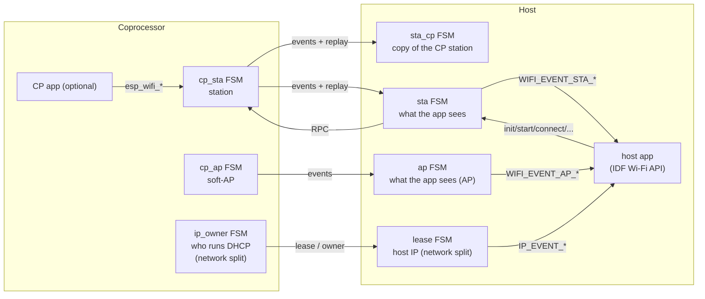
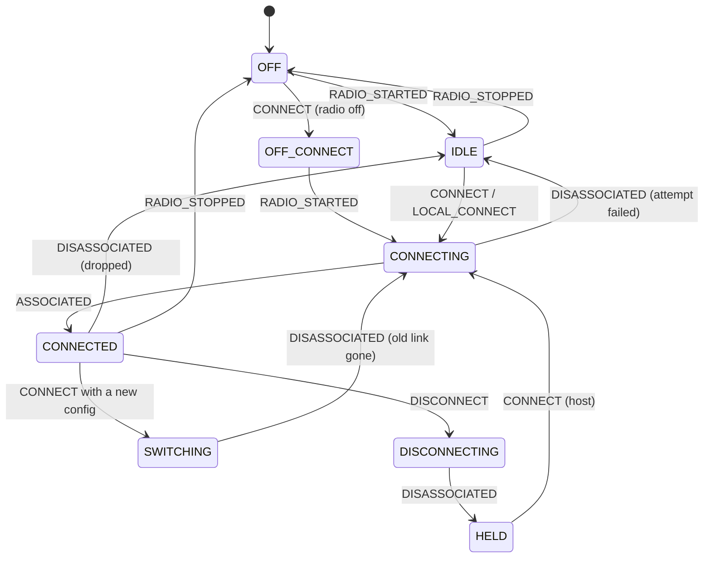
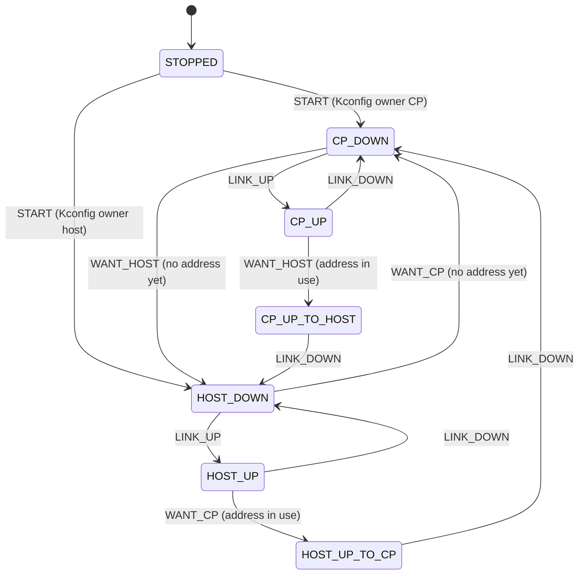
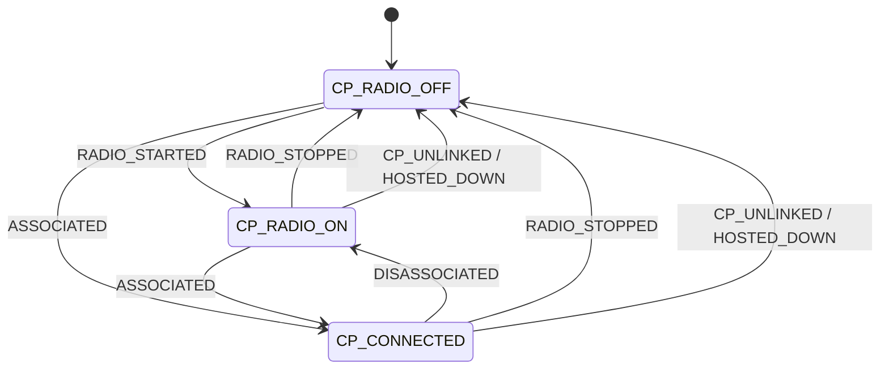
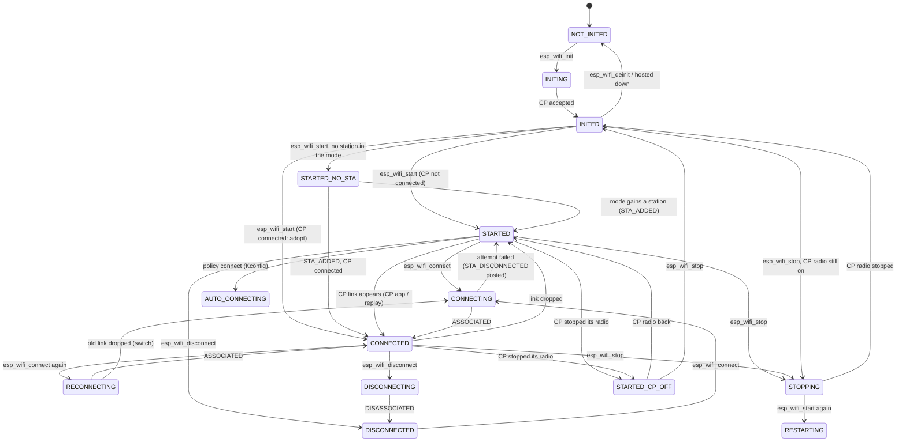
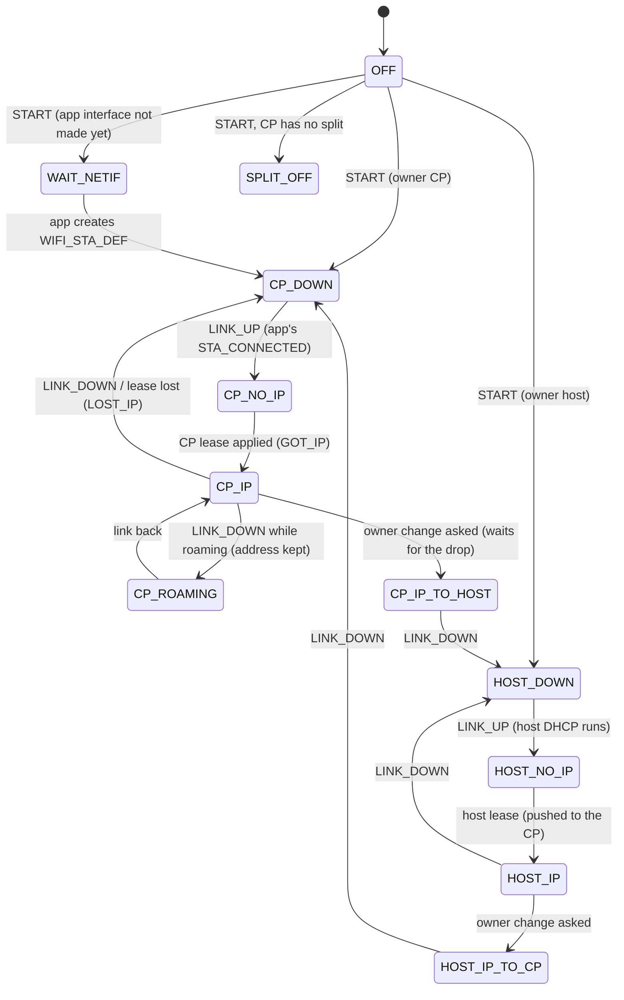
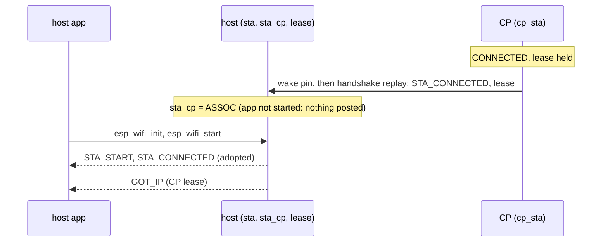
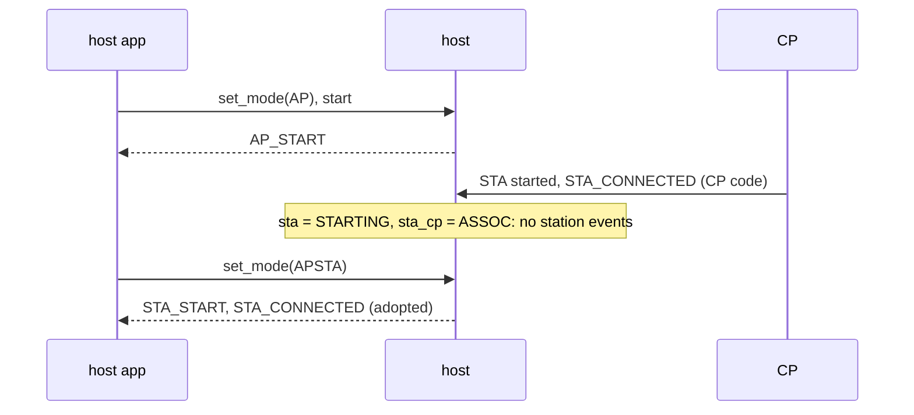
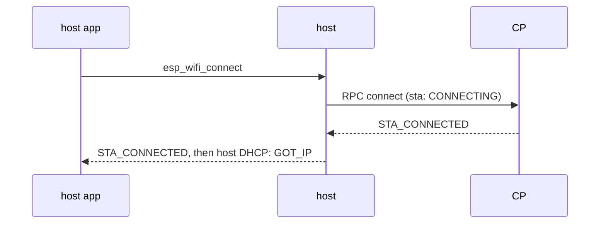

# Wi-Fi state machines

[Home](../../README.md) · [Design](README.md) · [Wi-Fi Design](wifi.md)

How ESP-Hosted keeps the host app's Wi-Fi view and the CP's real Wi-Fi in step.
Every state machine is a flat `[state][event]` table on `eh_fsm`
(`common/eh_common/include/eh_fsm.h`): every cell names one handler, so every
event has one defined outcome in every state.

## The rule in one line

**The CP is transparent; the host is smart.**

- The CP runs real ESP-IDF Wi-Fi. It executes what the host asks and reports
  what IDF reports.
- The host decides what its app is told, so the app behaves as if Wi-Fi were
  on its own chip.

## Who talks to whom

| FSM | Lives on | Job |
|---|---|---|
| `cp_sta` | CP | The station as IDF runs it: radio, link, attempt, held after a disconnect. |
| `cp_ap` | CP | Soft-AP on or off. |
| `ip_owner` | CP | Network split: who runs DHCP for the shared address, the CP or the host. |
| `sta_cp` | host | Copy of the CP station (off / on / connected), whatever the app did. |
| `sta` | host | The station as the host app sees it, in IDF's event order. |
| `ap` | host | The soft-AP as the host app sees it. |
| `lease` | host | Network split: puts the shared IP on the host interface. |

---

## CP side

### `cp_sta`: the CP's station

| State | Meaning |
|---|---|
| OFF | radio stopped |
| OFF_CONNECT | a connect arrived while stopped; runs when the radio starts |
| IDLE | radio on, no link, no attempt |
| CONNECTING | an attempt runs |
| CONNECTED | associated |
| SWITCHING | associated, a new config asked: drop first, then connect |
| DISCONNECTING | the host asked to leave; waiting for IDF's report |
| HELD | the host left; CP code may not reconnect until the host connects again |

| Event | From |
|---|---|
| RADIO_STARTED / RADIO_STOPPED / ASSOCIATED / DISASSOCIATED | IDF events on the CP |
| CONNECT, DISCONNECT, SET_CONFIG, START | host RPCs |
| LOCAL_CONNECT | CP app's `esp_wifi_connect` (wrapped) |
| RESYNC | the host (re)connected: replay the link if CONNECTED |
| SYNC, DEINIT | feature started after the app / feature stopped |

**Replay.** When the host connects (boot, wake, handshake) or starts Wi-Fi
while the CP is CONNECTED, the CP re-sends STA_CONNECTED (and, in network split,
its lease). That is how a host that rebooted learns the link the CP kept.

### `cp_ap`: the CP's soft-AP

`OFF ⇄ ON` on IDF's AP_START / AP_STOP. SYNC adopts the driver state, DEINIT
goes OFF.

### `ip_owner`: who runs DHCP (network split)

- A switch asked while an address is in use waits for the next link drop.
  Stopping a bound DHCP client would release an address the other side is using.
- HOST_LEASE: the host pushes its address. The CP takes it only when the host
  owns the IP.

---

## Host side

### `sta_cp`: copy of the CP station

- Fed by every CP report, in every app state. It never posts anything to the app.
- `sta` reads it at one moment only: when the app's station begins (its
  `esp_wifi_start`, or a mode change that adds a station). If the copy is
  CP_CONNECTED, the app adopts the CP's link at once.

### `sta`: what the host app sees

| State | What the app has been told |
|---|---|
| NOT_INITED, INITING | nothing; Wi-Fi not initialised |
| INITED | initialised, not started: nothing reaches the app, whatever the CP does |
| STARTED_NO_STA | started, but its mode has no station (AP only): no station events |
| STARTED | STA_START; not connected; no attempt of its own |
| CONNECTING / AUTO_CONNECTING | its own (or the policy's) attempt runs; only that attempt's failure is posted |
| CONNECTED | STA_CONNECTED |
| RECONNECTING | connected; it connected again: the CP replays (same AP, no event) or switches |
| DISCONNECTING / DISCONNECTED | it disconnected; DISCONNECTED keeps CP code from reconnecting it |
| STARTED_CP_OFF | started, but the CP stopped its radio (mode change, CP re-init) |
| STOPPING, RESTARTING, RESTARTING_CONNECTING | stop / quick stop-start in flight, waiting for the CP's report |

**What `sta` posts.** Its edges post IDF's events in IDF's order:
- STA_START when entering a radio-on state, STA_STOP when leaving one;
- STA_CONNECTED when entering an associated state, STA_DISCONNECTED when
  leaving one;
- STA_DISCONNECTED always before STA_STOP, STA_CONNECTED always after STA_START.

**Order of CP reports.** A CP report sent before an RPC reply is applied before
the request that reply completes: the CP lets its event loop send what a Wi-Fi
request caused before it replies, and the host applies CP reports in the RX
task in arrival order. Reports that come after a reply (the CP's STA_START of a
start, its STA_STOP of a stop) are absorbed by the STOPPING / RESTARTING cells.

**Return codes.** `esp_wifi_connect` before start returns
`ESP_ERR_WIFI_NOT_STARTED`; queries before init return
`ESP_ERR_WIFI_NOT_INIT`; same as IDF.

| Event | From |
|---|---|
| INIT_REQ, START_REQ, STOP_REQ, CONNECT_REQ, DISCONNECT_REQ, DEINIT_REQ | the app's IDF call, before the RPC |
| INIT_CLAIM / INIT_FAIL, CONNECT_FAIL, DISCONNECT_FAIL | RPC results |
| AUTO_CONNECT_REQ | connect-on-start / reconnect-on-drop policy (Kconfig) |
| STA_ADDED | `esp_wifi_set_mode` added a station while the app's Wi-Fi runs |
| RADIO_STARTED, RADIO_STOPPED, ASSOCIATED, DISASSOCIATED | CP reports |
| LEASE_READY | network split: the CP's lease arrived |
| CP_UNLINKED | the CP came back without a link (it rebooted) |
| HOSTED_DOWN | hosted deinit |

### `ap`: what the host app sees for the soft-AP

| State | Meaning |
|---|---|
| OFF_IDLE / ON_IDLE | app not started; CP AP off / on |
| STARTING | app started, CP's start report pending |
| ON | AP_START posted |
| OFF_APP | app started, no AP in its mode (or the CP stopped it) |
| STOPPING / RESTARTING | stop / quick stop-start in flight |

### `lease`: the host's IP (network split only)

- CP_* rows apply the CP's lease to the host interface; the host DHCP client
  never runs. It is stopped at STA_CONNECTED and re-armed at STA_DISCONNECTED,
  both in the same handler pass as esp_netif. A reconnect queued behind the
  disconnect then finds it armed; a stopped client makes esp_netif post the old
  address as a static GOT_IP.
- HOST_* rows run the host DHCP client and push the address to the CP.
- The link comes from the app's STA_CONNECTED. So in network split **the app
  must call `esp_wifi_init` + `esp_wifi_start`**. Connect is optional: a link
  the CP holds is adopted.

---

## Flows

### Host wakes from deep sleep; the CP kept the link (network split)

### Host app AP only; CP code connects the station; app later adds a station

### The app connects (plain mode)

### A failed attempt the app did not make

The CP app connects to a missing AP. `cp_sta` goes CONNECTING → IDLE and
reports DISASSOCIATED. Host `sta` is IDLE, so nothing reaches the host app: the
attempt was not its own.

---

## Known limits

- Network split: a host app that never calls `esp_wifi_init` + `esp_wifi_start`
  gets no IP, even when the CP is connected.
- The CP restarting on its own is not detected on SDIO/SPI-HD (open, "bug B").
- SDIO, "reset CP only if needed": after a host reboot, the CP's hello can be
  lost if a CP message was unread at the moment of the reset.
