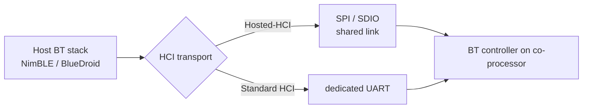

# Bluetooth

[Home](../../README.md) · [Getting Started: Linux](../getting-started-linux.md) · [Getting Started: MCU](../getting-started-mcu.md) · [Troubleshooting](../troubleshooting.md)

The host runs the Bluetooth application and host stack; the co-processor runs the Bluetooth controller and radio. ESP-Hosted carries HCI packets between them, so it is stack-agnostic — bring your own stack if you prefer.

---

## Host support

| Linux host | MCU host |
| :---: | :---: |
| Yes | Yes |

Bluetooth/BLE works on **both** hosts — the integration differs:

- **Linux host** — the ESP-Hosted kernel module presents a standard HCI interface to the Linux Bluetooth subsystem, so you run your normal host stack (e.g. **BlueZ**) directly on it. HCI rides the same SDIO/SPI transport as Wi-Fi. **You do not need the ESP-Hosted Bluetooth examples on Linux** — those target MCU/ESP-IDF hosts.
- **MCU host** — the host firmware runs a BT host stack (NimBLE or BlueDroid) and ESP-Hosted carries HCI to the controller. That path is covered in the rest of this page.

> [!NOTE]
> Classic Bluetooth requires an **ESP32** or **ESP32-S31** co-processor. All other ESP chips provide **BLE only**. On an MCU host with an ESP32 co-processor, the host stack must also be Bluetooth v4.2.

---

## Linux host: use BlueZ directly

Once the transport is up on Linux (see [Getting Started: Linux](../getting-started-linux.md) and your bus page), the kernel module exposes a standard HCI device to the Linux Bluetooth stack. From there, Bluetooth is managed with the ordinary BlueZ tooling — nothing ESP-Hosted-specific:

```sh
hciconfig hci0 up      # bring the HCI interface up
bluetoothctl           # scan, pair, connect as usual
```

Because the kernel presents a normal HCI interface, existing BlueZ applications work unchanged. The ESP-Hosted Bluetooth examples are **not** used on Linux — they exist for MCU/ESP-IDF hosts that must supply their own host stack.

---

## MCU host: choose stack and HCI transport

**Host stack — NimBLE vs BlueDroid:**

- **NimBLE** (`esp-nimble`) — BLE only. Smaller code and RAM footprint; recommended for BLE-only use cases.
- **BlueDroid** (`esp-bluedroid`) — Classic BT **and** BLE. Use this when you need Classic Bluetooth.

**HCI transport — Hosted-HCI vs standard UART-HCI:**

| | Hosted-HCI | Standard HCI (UART) |
| :--- | :--- | :--- |
| Wiring | Reuses the existing SPI/SDIO transport | Needs a **dedicated UART** + extra GPIOs |
| Multiplexing | Shares the link with Wi-Fi and other traffic | Dedicated link, BT only |
| Overhead | Adds an ESP-Hosted header to each HCI frame | Transparent — raw HCI, no extra bytes |
| Best for | Easiest setup once a transport exists | Portability; swap in any HCI controller |

> [!NOTE]
> Hosted-HCI and standard HCI are mutually exclusive — enabling one requires disabling the other.



---

## Enable / disable

Pick the HCI transport in `menuconfig`. **Hosted-HCI** (the default, over the existing SPI/SDIO link) needs no BT-specific menuconfig; for **standard HCI over UART**, set the controller HCI mode to `UART(H4)` on the co-processor:

```text
Co-processor (standard HCI over UART):
Component config
└── Bluetooth
     └── Controller Options
          └── HCI mode
               └── (X) UART(H4)                              <------- Enable this
Example Configuration
└── HCI UART Settings                                             (set UART Tx/Rx/flow pins)
```

Hosted-HCI and standard UART-HCI are mutually exclusive — enabling one disables the other. Make sure any UART GPIOs do not clash with the ESP-Hosted transport pins.

For **Hosted-HCI**, enable the HCI byte-pipe and pick the host stack with the standard IDF BT Kconfig — the `esp_hosted_bt_host_stack` stack adapter is built into the `esp_hosted` component, there is no separate bridge component and no hosted BT-port knob:

```ini
CONFIG_ESP_HOSTED_HOST_FEAT_BT=y     # HCI byte-pipe over the transport
CONFIG_BT_NIMBLE_ENABLED=y           # …or CONFIG_BT_BLUEDROID_ENABLED — chooses the stack
```

The app makes **one explicit call**, `esp_hosted_bt_host_stack_setup()`, before initialising the stack itself — no auto-init, no background task:

```c
esp_hosted_bt_host_stack_cfg_t cfg = ESP_HOSTED_BT_HOST_STACK_CONFIG_DEFAULT();  // stack from Kconfig
ESP_ERROR_CHECK(esp_hosted_bt_host_stack_setup(&cfg));   // MAC (opt) + controller up + HCI bound
// then the stack's own lifecycle:
//   NimBLE:   nimble_port_init();
//   BlueDroid: esp_bluedroid_init(); esp_bluedroid_enable();
```

`ESP_HOSTED_BT_HOST_STACK_CONFIG_DEFAULT()` selects NimBLE or BlueDroid from the IDF BT Kconfig above (neither ⇒ a custom stack — see [Bluetooth Design → Porting a BT stack](../design/bluetooth.md#porting-a-bt-stack-to-esp-hosted)). `setup()` (optionally) applies the BT MAC, brings up the CP controller, and binds the chosen stack to the HCI pipe; `esp_hosted_bt_host_stack_teardown()` is the symmetric counterpart.

`setup()` drives the controller lifecycle for you. The controller is **disabled by default** (since ESP-Hosted-MCU v2.5.2) so the BT MAC can be set first — supply it via `cfg.bt_mac` (runtime) or `CONFIG_ESP_HOSTED_HOST_FEAT_BT_MAC` (build-time). A bring-your-own-driver app that skips the adapter drives feat_bt directly instead:

1. `esp_hosted_connect_to_slave()` — initialise the transport.
2. (Optional) `esp_hosted_iface_mac_addr_get()` / `esp_hosted_iface_mac_addr_set()` — read/set the BT MAC (temporary until reset).
3. `esp_hosted_bt_controller_init()` then `esp_hosted_bt_controller_enable()`.
4. Initialise your BT host stack (NimBLE or BlueDroid).

**To disable / tear down:** call `esp_hosted_bt_host_stack_teardown()` after de-initing the host stack — or, on the manual path, `esp_hosted_bt_controller_disable()` then `esp_hosted_bt_controller_deinit()`.

---

## BLE TX power

The host can set and get the BLE TX power of the co-processor controller. Kconfig `ESP_HOSTED_HOST_FEAT_BT_TX_POWER` (host) and `ESP_HOSTED_CP_FEAT_BT_TX_POWER` (co-processor) enable it. Both are on by default when the BT feature is on.

**IDF API (`#include "esp_bt.h"`).** On a host without its own BT controller (for example ESP32-P4), ESP-Hosted gives the IDF functions `esp_ble_tx_power_set/get()` and `esp_ble_tx_power_set_enhanced/get_enhanced()`. The `ESP_PWR_LVL_*` values are those of the co-processor chip that `ESP_HOSTED_CP_TARGET` selects, as in IDF on that chip.

**ESP-Hosted API (`eh_host_bt.h`).** `eh_host_bt_ble_tx_power_*()` take the same arguments. The level is an `eh_power_level_t` name (`EH_PWR_LVL_P9` = +9 dBm). The name has the same value for all co-processors, so one host binary works with any co-processor.

The co-processor applies the level by its name. If the host is configured for a different co-processor chip:

- A level that the real co-processor has gets the correct dBm.
- A level that it does not have gives `ESP_ERR_NOT_SUPPORTED`.

| Result | Cause |
| :--- | :--- |
| `ESP_ERR_INVALID_STATE` | The co-processor controller is not initialized. Call `esp_hosted_bt_controller_init()` first. |
| `ESP_ERR_NOT_SUPPORTED` | The co-processor chip has no such level or `_enhanced` power type. ESP32 has no `_enhanced` API. The co-processor has `ESP_HOSTED_CP_FEAT_BT_TX_POWER` or Bluetooth disabled. |
| `ESP_FAIL` | No response. Co-processor firmware older than this feature does not reply, so the call returns after the RPC timeout. |
| `ESP_ERR_INVALID_ARG` | The value is not a level name, or the power type of `esp_ble_tx_power_set()` is `ESP_BLE_PWR_TYPE_NUM` or higher. |
| `ESP_PWR_LVL_INVALID` from a get | The get failed. On an ESP32 co-processor the IDF API returns `-1`, because ESP32 has no `ESP_PWR_LVL_INVALID`. |

An extended-advertising `tx_power` that the host stack sends over HCI overrides this level for that advertising set, as in IDF.

### Level values per chip

In IDF, `esp_power_level_t` is an index into the power table of the chip, not a dBm value. The same name has a different value on different chips: `ESP_PWR_LVL_P9` is 7 on ESP32 and 11 on ESP32-C6. The name gives the nominal TX power. The real output depends on the chip, the board and the RF calibration.

- **Number**: the `ESP_PWR_LVL_*` value in IDF for that chip. The compat `esp_bt.h` uses the value of the chip that `ESP_HOSTED_CP_TARGET` selects.
- **`*`**: an IDF alias. It has the same value as the next canonical level, so it gives that level's power. For example, on ESP32 `N14` gives -12 dBm. A get returns the canonical name.
- **—**: the chip has no such name. Its use does not compile with the compat `esp_bt.h`. Through `eh_host_bt_ble_tx_power_set()` it gives `ESP_ERR_NOT_SUPPORTED`.
- **ESP-Hosted wire value**: `EH_PWR_LVL_N<x>` = 100 + x and `EH_PWR_LVL_P<x>` = 200 + x, the same for every chip (`eh_bt_tx_power.h`).

<!-- bt-tx-power-levels:begin -->
| Level | Nominal dBm | ESP32 | C2 | C3, S3 | C5 | C6, C61 | H2, H21 | H4, S31 |
|---|---|---|---|---|---|---|---|---|
| `N24` | -24 | — | 0 | 0 | 0 | — | 0 | 0 |
| `N21` | -21 | — | 1 | 1 | 1 | — | 1 | 1 |
| `N18` | -18 | — | 2 | 2 | 2 | — | 2 | 2 |
| `N15` | -15 | — | 3 | 3 | 3 | 3 | 3 | 3 |
| `N14` | -14 | 0* | — | — | — | — | — | — |
| `N12` | -12 | 0 | 4 | 4 | 4 | 4 | 4 | 4 |
| `N11` | -11 | 1* | — | — | — | — | — | — |
| `N9` | -9 | 1 | 5 | 5 | 5 | 5 | 5 | 5 |
| `N8` | -8 | 2* | — | — | — | — | — | — |
| `N6` | -6 | 2 | 6 | 6 | 6 | 6 | 6 | 6 |
| `N5` | -5 | 3* | — | — | — | — | — | — |
| `N3` | -3 | 3 | 7 | 7 | 7 | 7 | 7 | 7 |
| `N2` | -2 | 4* | — | — | — | — | — | — |
| `N0` | 0 | 4 | 8 | 8 | 8 | 8 | 8 | 8 |
| `P1` | +1 | 5* | — | — | — | — | — | — |
| `P3` | +3 | 5 | 9 | 9 | 9 | 9 | 9 | 9 |
| `P4` | +4 | 6* | — | — | — | — | — | — |
| `P6` | +6 | 6 | 10 | 10 | 10 | 10 | 10 | 10 |
| `P7` | +7 | 7* | — | — | — | — | — | — |
| `P9` | +9 | 7 | 11 | 11 | 11 | 11 | 11 | 11 |
| `P12` | +12 | — | 12 | 12 | 12 | 12 | 12 | 12 |
| `P15` | +15 | — | 13 | 13 | 13 | 13 | 13 | 13 |
| `P16` | +16 | — | — | — | — | — | 14* | 14 |
| `P17` | +17 | — | — | — | — | — | 14* | 15 |
| `P18` | +18 | — | 14 | 14 | 14 | 14 | 14 | 16 |
| `P19` | +19 | — | — | — | — | — | 15* | 17 |
| `P20` | +20 | — | 15 | 15 | 15 | 15 | 15 | 18 |
| `P21` | +21 | — | 15* | 15* | — | — | — | — |
| `INVALID` | — | — | 255 | 255 | 255 | 255 | 255 | 255 |
<!-- bt-tx-power-levels:end -->

Values are from ESP-IDF v5.5 to v6.1.1 (ESP32-H4 and ESP32-S31: v6.1 and later). `tests/unit/bt_tx_power` fails if this table differs from the IDF headers.

---

## Start here

- **Linux host** — no ESP-Hosted BT example needed. Bring up the transport via [Getting Started: Linux](../getting-started-linux.md), then use BlueZ (`bluetoothctl`) directly.
- **MCU host** — [Bluetooth Examples](../../examples/bluetooth/README.md): NimBLE and BlueDroid samples over Hosted-HCI and UART.

---

## See also

- [Bluetooth Design](../design/bluetooth.md) — HCI init / send / receive flows for both stacks.
- [Supported co-processors](../getting-started-mcu.md#supported-esp-co-processors) — which chip gives Classic BT vs BLE.
- [Getting Started: MCU](../getting-started-mcu.md)
