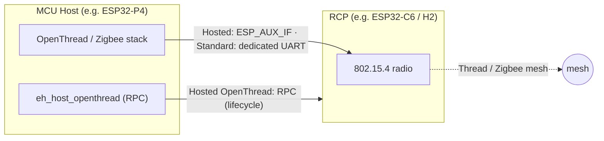
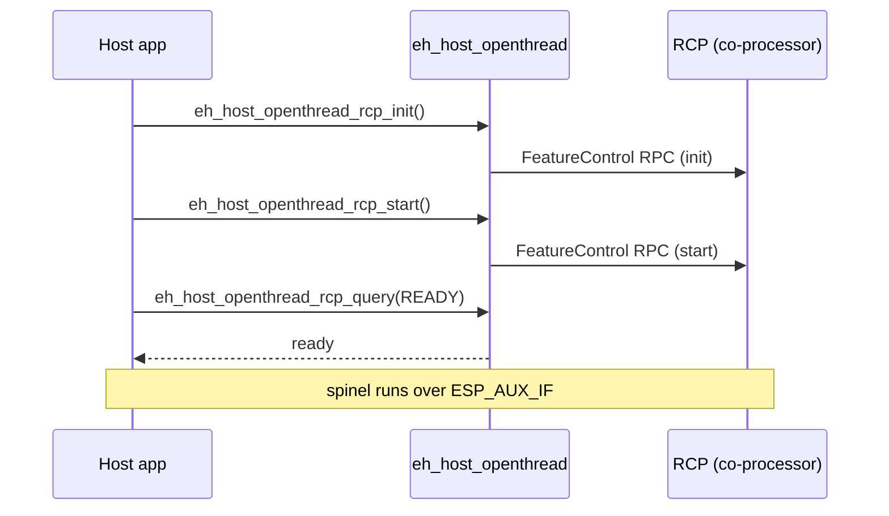

# OpenThread / Zigbee

[Home](../../README.md) · [Getting Started: Linux](../getting-started-linux.md) · [Getting Started: MCU](../getting-started-mcu.md) · [Troubleshooting](../troubleshooting.md)

The MCU host runs the full 802.15.4 stack (OpenThread, or Zigbee), while a separate ESP chip acts as the **Radio Co-Processor (RCP)**. Your host application drives the mesh; the RCP just provides the radio. Both stacks share the same RCP mechanism.

---

## Host support

| Linux host | MCU host | Capability bits in `ext_cap` |
| :---: | :---: | :--- |
| No | Yes | `ESP_EXT_CAP_OT` (`1 << 6`) and `ESP_EXT_CAP_AUX_OT` (`1 << 18`): the co-processor runs hosted OpenThread, with spinel on the ESP-Hosted transport. Standard OpenThread sets neither. |

---

## How it works

There are two ways to connect the host's OpenThread or Zigbee stack to an RCP. They work like hosted HCI and standard HCI for Bluetooth.

- **Hosted OpenThread** (this feature): the RCP runs on the ESP-Hosted co-processor. Spinel goes on the same SPI, SDIO or UART bus as Wi-Fi and RPC, as `ESP_AUX_IF` frames. No extra pins are necessary. RCP lifecycle control uses RPC ext-v2. Both sides need an ESP-IDF that has the OpenThread custom transport, ESP-IDF commit [`8c87790e47`](https://github.com/espressif/esp-idf/commit/8c87790e47b6aeccb6ec94cd77534cb0564442c8): `CONFIG_OPENTHREAD_RCP_CUSTOM` on the co-processor and `CONFIG_OPENTHREAD_RADIO_SPINEL_CUSTOM` on the host. As of 2026-11-05 it is in ESP-IDF master and release/v6.2 (no release tag yet), and not in v6.1.x, v6.0.x or v5.x. Without it, the feature stays off, and the `rcp_on_hosted_cp` examples stop the build with `#error`.
- **Standard OpenThread**: spinel goes on a dedicated UART, as in ESP-IDF `ot_rcp` and `ot_cli`. ESP-Hosted does not carry spinel and has no part in it. The RCP app calls `esp_openthread_start()` with `HOST_CONNECTION_MODE_RCP_UART`, and the host app uses a `RADIO_MODE_UART_RCP` config. The RCP can be the ESP-Hosted co-processor (ESP-Hosted still runs there for Wi-Fi) or a separate chip. Zigbee uses only this link.



### Hosted OpenThread: RCP lifecycle



`eh_host_openthread_rcp_start()` is safe to call more than once. It opens the spinel channel before it starts the RCP, so no RCP frame is lost. `eh_host_openthread_rcp_stop()` stops the RCP and then closes the channel.

An ESP-IDF OpenThread example runs on the host with one change: `ESP_OPENTHREAD_DEFAULT_RADIO_CONFIG()` in its `esp_ot_config.h`.

- Hosted OpenThread: set it to `ESP_HOSTED_OPENTHREAD_RADIO_CONFIG()` (`EH_HOST_PORT_OPENTHREAD_RADIO_CONFIG()`). OpenThread gets `eh_host_openthread_transport_tx` and `eh_host_openthread_transport_rx`. The first spinel write calls `eh_host_openthread_rcp_start()`. If the co-processor does not run hosted OpenThread (no `ESP_EXT_CAP_AUX_OT`), the start fails with `ESP_ERR_NOT_SUPPORTED` and a log.
- Standard OpenThread: set it to a `RADIO_MODE_UART_RCP` config with the UART port, baud rate and pins of your board, as in ESP-IDF `ot_br`. The ESP-Hosted OpenThread feature stays inactive: it needs `CONFIG_OPENTHREAD_RADIO_SPINEL_CUSTOM`.

### Which setup?

The RCP must be a chip with an 802.15.4 radio (ESP32-C6, ESP32-C5, ESP32-H2 or ESP32-H21).

| Setup | Chips | Spinel link | Use it when |
| :--- | :--- | :--- | :--- |
| A. Hosted OpenThread | Host + C6 or C5 (Wi-Fi and 802.15.4) | ESP-Hosted transport (`ESP_AUX_IF`) | You want the fewest pins. Both sides need the OpenThread custom transport. |
| B. Standard OpenThread, RCP on the co-processor | Host + C6 or C5 | Dedicated UART | Your ESP-IDF does not have the custom transport, or the host stack is Zigbee. The co-processor app starts the RCP; ESP-Hosted carries only Wi-Fi and RPC. |
| C. Standard OpenThread, RCP on a separate chip | Host + co-processor for Wi-Fi/BLE + H2 or H21 for 802.15.4 | Dedicated UART to the RCP chip | You want 802.15.4 on its own radio, with no coexistence with Wi-Fi or BLE. The RCP runs the ESP-IDF `ot_rcp` firmware. Example: [`rcp_separate_chip/border_router`](../../examples/openthread/rcp_separate_chip/border_router/README.md). |

---

## Enable / disable

Hosted OpenThread: enable the feature on both sides, with the OpenThread custom transport. Standard OpenThread needs no ESP-Hosted setting: with the UART spinel link selected in ESP-IDF, the feature stays inactive, and the apps set the UART.

### Host:

```text
Component config
└── ESP-Hosted
    └── Configure host
        └── Features
            └── [*] OpenThread RCP on the co-processor (spinel over ESP-Hosted)   (ESP_HOSTED_HOST_FEAT_OPENTHREAD)
                └── (16) Spinel receive queue length                              (ESP_HOSTED_OT_HOST_HOSTED_RX_QUEUE_LEN)
Component config
└── OpenThread
    └── Thread Core Features
        └── Thread 15.4 Radio Link
            └── Config the Thread radio type with 15.4 link → (X) Connect via Custom Transport (OPENTHREAD_RADIO_SPINEL_CUSTOM)
```

### Co-processor (RCP):

```text
Component config
└── ESP-Hosted
    └── Configure coprocessor
        └── Features
            └── [*] OpenThread RCP (Radio Co-Processor)                           (ESP_HOSTED_CP_FEAT_OPENTHREAD)
                └── (4096) Spinel receive buffer size                             (ESP_HOSTED_OT_HOSTED_RX_BUF_SIZE)
Component config
└── OpenThread
    └── Thread Core Features
        └── Thread Radio Co-Processor Feature
            └── The RCP transport type → (X) Custom Transport RCP                 (OPENTHREAD_RCP_CUSTOM)
```

The RCP firmware itself needs the ESP-IDF OpenThread radio config (`CONFIG_OPENTHREAD_ENABLED=y`, `CONFIG_OPENTHREAD_RADIO=y`, device type = Radio-only).

For standard OpenThread on the co-processor, the `rcp_on_hosted_cp` and Zigbee co-processor examples start the RCP when `CONFIG_OPENTHREAD_RCP_UART=y`. They take the UART from `EXAMPLE_RCP_UART_PORT`, `EXAMPLE_RCP_UART_TX_PIN`, `EXAMPLE_RCP_UART_RX_PIN` and `EXAMPLE_RCP_UART_BAUDRATE`. The host examples take theirs from `EXAMPLE_HOST_UART_*` when `CONFIG_OPENTHREAD_RADIO_SPINEL_UART=y`. The co-processor build fails if the spinel UART port is the ESP-Hosted UART transport port.

---

## Start here

- [All OpenThread examples, by setup](../../examples/openthread/README.md).
- [OpenThread CLI](../../examples/openthread/rcp_on_hosted_cp/cli/README.md) — bring up a Thread node from the interactive CLI.
- [Thread Border Router](../../examples/openthread/rcp_on_hosted_cp/border_router/README.md) — Wi-Fi + 802.15.4 gateway.
- [Thread Border Router, separate RCP](../../examples/openthread/rcp_separate_chip/border_router/README.md) — three chips: host, Wi-Fi/BLE co-processor, H2 RCP.
- [Zigbee Thermostat](../../examples/zigbee/thermostat/README.md) — Zigbee host stack, standard RCP on the co-processor.

---

## Code reference

- `host/features/eh_host_feat_openthread/include/eh_host_openthread.h` — `eh_host_openthread_rcp_init/start/stop/deinit/query`.
- `host/features/eh_host_feat_openthread/include/eh_host_openthread_transport.h` — spinel over the ESP-Hosted transport (`ESP_AUX_IF`, `ESP_AUX_OT`).
- `port/os/include/eh_host_port_openthread.h` — `EH_HOST_PORT_OPENTHREAD_RADIO_CONFIG()` for the ESP-Hosted transport.
- `coprocessor/features/eh_cp_feat_openthread/` — RCP feature on the co-processor.

---

## See also

- [Supported co-processors](../getting-started-mcu.md#supported-esp-co-processors) — 802.15.4-capable chips.
- [Architecture & Protocol](../architecture.md) · [Getting Started: MCU](../getting-started-mcu.md)
