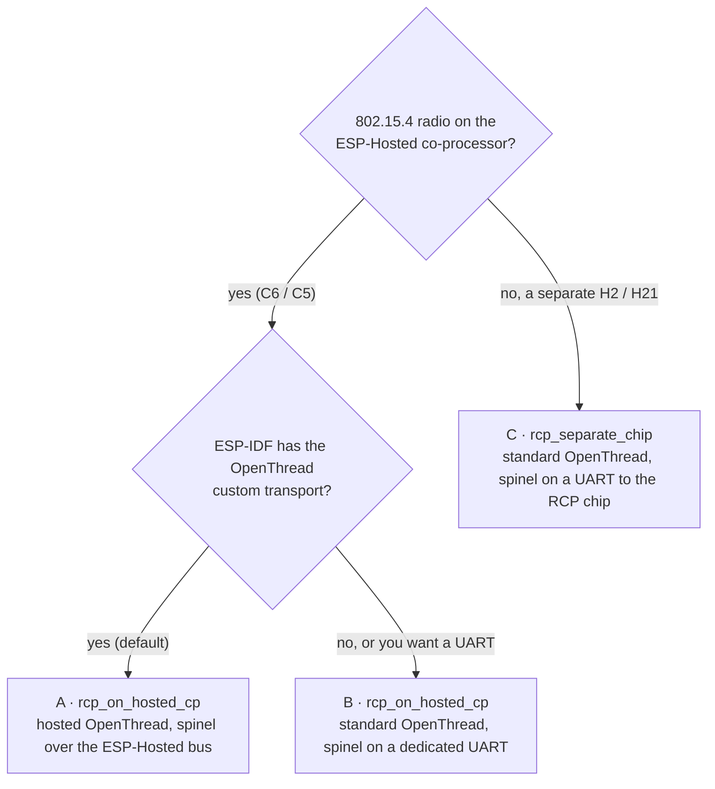

# ESP-Hosted OpenThread examples

> [!NOTE]
> **These examples are for MCU / ESP-IDF hosts.** The Linux host does not support OpenThread.

## Hierarchy

```text
examples/openthread/<family>/<scenario>/<role>/
```

- `<family>`: where the 802.15.4 RCP runs.
  - `rcp_on_hosted_cp`: the ESP-Hosted co-processor is also the RCP. Two chips.
  - `rcp_separate_chip`: a separate chip is the RCP, on a dedicated spinel UART. The co-processor carries only Wi-Fi and BLE. Three chips.
- `<role>`: `cp` (ESP-Hosted co-processor), `esp_host` (ESP-IDF MCU host), `cp_rcp` (separate RCP chip).

```text
examples/openthread/
├── rcp_on_hosted_cp/          # Host + C6 or C5 (Wi-Fi and 802.15.4)
│   ├── cli/{cp,esp_host}
│   └── border_router/{cp,esp_host}
└── rcp_separate_chip/         # Host + C5 (Wi-Fi/BLE) + H2 or H21 (802.15.4)
    └── border_router/{cp,cp_rcp,esp_host}
```

## Which setup?



| Setup | Spinel link | Who starts the RCP | What you set |
| :--- | :--- | :--- | :--- |
| **A** (default) | ESP-Hosted bus, `ESP_AUX_IF` frames | The ESP-Hosted OpenThread feature, on the host's request | Nothing: `sdkconfig.defaults` |
| **B** | Dedicated UART; ESP-Hosted does not carry spinel | The co-processor app, at boot (as ESP-IDF `ot_rcp`) | `CONFIG_OPENTHREAD_RCP_UART=y` + `EXAMPLE_RCP_UART_*` (co-processor), `CONFIG_OPENTHREAD_RADIO_SPINEL_UART=y` + `EXAMPLE_HOST_UART_*` (host) |
| **C** | Dedicated UART to the H2 / H21 | The RCP chip (ESP-IDF `ot_rcp` firmware) | See its README |

Like Bluetooth's hosted HCI and standard HCI: in A, ESP-Hosted carries the radio traffic; in B and C, it does not.

## Zigbee

[`examples/zigbee/thermostat`](../zigbee/thermostat/README.md) uses standard OpenThread on the co-processor, with spinel on the dedicated UART (setup B). The host runs the Zigbee stack instead of OpenThread.

More: [OpenThread feature](../../docs/features/openthread.md).
