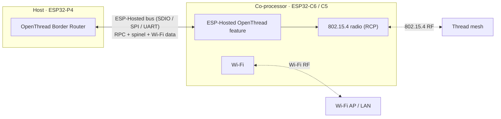
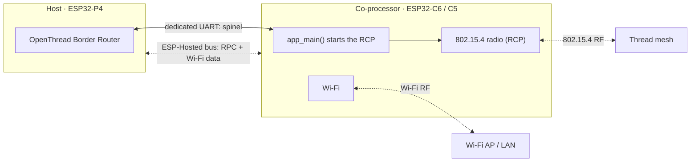
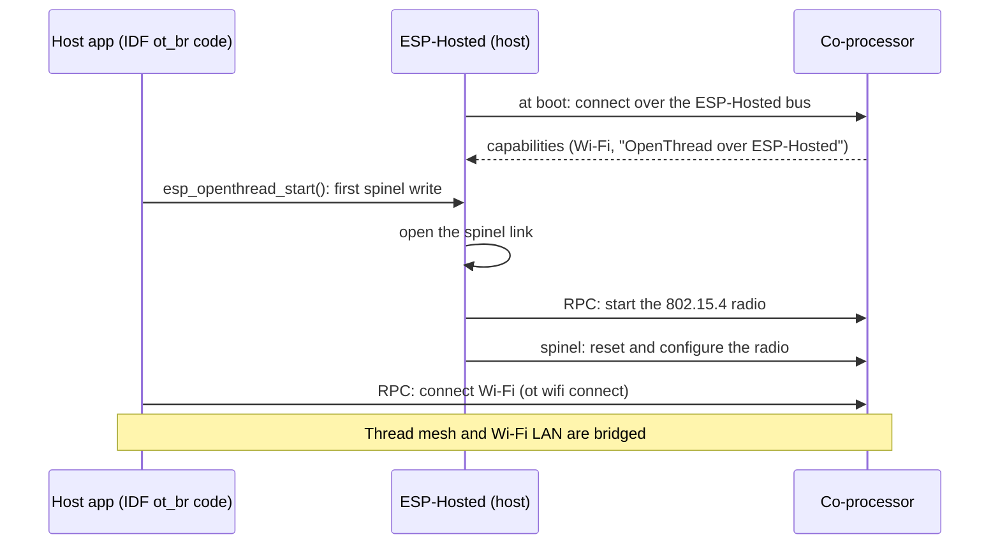

# Thread Border Router — RCP on the ESP-Hosted co-processor (`openthread/rcp_on_hosted_cp/border_router`)

<!-- common-start -->
A Thread Border Router on the host. It connects a Thread mesh to your Wi-Fi network. One co-processor gives the host **two radios**: the 802.15.4 radio for Thread (the Radio Co-Processor, RCP) and Wi-Fi for the backhaul. The host runs the full border router stack (border routing, mDNS, NAT64). Adapted from `esp-idf/examples/openthread/ot_br`.

## How it works

The host runs the OpenThread Border Router (mDNS, NAT64). The co-processor is its 802.15.4 radio, the Radio Co-Processor (RCP). Spinel, the protocol between the Thread stack and the radio, takes one of two paths. Pick one; both sides must match.

### Default: spinel over the ESP-Hosted bus (hosted OpenThread)

Nothing to set: `sdkconfig.defaults` select this. No extra wires.



Needs an ESP-IDF with the OpenThread custom transport (ESP-IDF master).

### Option: spinel on a dedicated UART (standard OpenThread)

Like ESP-IDF `ot_rcp` + `ot_br`: ESP-Hosted does not carry spinel. Two extra wires (TX, RX). Use it when your ESP-IDF has no custom transport; ESP-IDF then selects UART on its own.



| Set this | Co-processor (`cp`) | Host (`esp_host`) |
| :--- | :--- | :--- |
| Spinel link (ESP-IDF OpenThread menu) | `CONFIG_OPENTHREAD_RCP_UART=y` | `CONFIG_OPENTHREAD_RADIO_SPINEL_UART=y` |
| UART pins, port, baud (Example Configuration) | `EXAMPLE_RCP_UART_*` | `EXAMPLE_HOST_UART_*` |

The ESP-Hosted OpenThread feature then stays inactive on both sides; leave its setting as it is.

### Start-up (default path)



The app is the ESP-IDF `ot_br` code. In `esp_ot_config.h`, `ESP_OPENTHREAD_DEFAULT_RADIO_CONFIG()` is `ESP_HOSTED_OPENTHREAD_RADIO_CONFIG()` on the ESP-Hosted transport. On the dedicated UART, it is a UART config from `EXAMPLE_HOST_UART_*`, and ESP-Hosted has no part in OpenThread.

> [!NOTE]
> Thread and Wi-Fi share one radio on the ESP32-C6, so each gets part of the air time. For two separate radios (P4 + C6 for Wi-Fi + H2 for Thread), see the [ESP-Thread-BR P4 example](https://github.com/espressif/esp-thread-br/blob/main/examples/basic_thread_border_router/README_esp32p4.md) and the [C6 coexistence guide](https://docs.espressif.com/projects/esp-idf/en/latest/esp32c6/api-guides/coexist.html).

## Supported Platforms and Transports

### Supported Coprocessors

OpenThread uses an 802.15.4 radio co-processor (RCP).

| Coprocessor | ESP32-C6 | ESP32-H2 | ESP32-H4 | ESP32-C5 |
| :---------: | :------: | :------: | :------: | :------: |
| Support     | Yes      | Yes      | Yes      | Yes      |

### Supported Host Devices

| Host Device | ESP32-P4 | ESP32-H2 | Other MCUs | Linux |
| :---------: | :------: | :------: | :--------: | :---: |
| Support     | Yes | Yes | [Yes](https://github.com/espressif/esp-hosted/blob/master/docs/getting-started-mcu.md) | [Yes](https://github.com/espressif/esp-hosted/blob/master/docs/getting-started-linux.md) |

### Supported Connection buses

| Connection bus | SDIO | SPI Full-Duplex | SPI Half-Duplex | UART |
| :------------- | :--: | :-------------: | :-------------: | :--: |
| Linux host     | Yes  | Yes             | No              | No   |
| MCU host       | Yes  | Yes             | Yes             | Yes  |
<!-- common-stop -->

## Directory layout

```text
openthread/border_router/
├── cp/                  ESP coprocessor firmware
└── esp_host/            ESP-IDF MCU host app
```

<table width="100%">
  <tr>
    <td width="100%" align="center" bgcolor="#f2ffe6">
      <h3><a href="#mcu-host-setup"> MCU Host Setup</a></h3>
      <p><a href="#mcu-cp">1. Coprocessor</a><br><a href="#mcu-host">2. MCU Host</a></p>
    </td>
  </tr>
</table>

---

> [!IMPORTANT]
> **New here? Get a base example working first.** Follow **[Getting Started: MCU](../../../../docs/getting-started-mcu.md)** to wire the boards, install tools, choose a transport, and confirm the host↔co-processor handshake. The steps below only add what is specific to this example.

<h2 id="mcu-host-setup"> MCU Host Setup</h2>

<h3 id="mcu-cp">1. Coprocessor</h3>

Set up the tools once (from the repo root):

```bash
cd /path/to/esp_hosted
./install.sh      # install.fish for the fish shell
. ./export.sh     # . ./export.fish for the fish shell
```

<!-- coprocessor-start -->
The co-processor is the 802.15.4 radio and the Wi-Fi backhaul.

```bash
cd examples/openthread/rcp_on_hosted_cp/border_router/cp
eh.py set-target esp32c6
eh.py menuconfig
```

Check two settings. Both must match the host. The defaults are correct for most setups.

1. **Bus to the host:**

   ```text
   Component config → ESP-Hosted → Configure coprocessor → CP transport
     └── Communication bus:  (X) SDIO   ( ) SPI Full Duplex   ( ) SPI Half Duplex   ( ) UART
   ```

2. **Spinel link** (ESP-IDF OpenThread menu):

   ```text
   Component config → OpenThread → Thread Core Features → Thread Radio Co-Processor Feature
     └── The RCP transport type:  (X) Custom Transport RCP   ( ) UART RCP
   ```

   - **Custom Transport RCP** (default): hosted OpenThread. Spinel goes over the ESP-Hosted bus, and `Features → OpenThread RCP` must stay on.
   - **UART RCP**: standard OpenThread. The app starts the RCP at boot on a dedicated UART, and ESP-Hosted does not carry spinel. Set the UART in *Example Configuration → Dedicated spinel UART* (`EXAMPLE_RCP_UART_PORT`, `_TX_PIN`, `_RX_PIN`, `_BAUDRATE`). `sdkconfig.defaults.esp32c6` sets the C6 pins. The port must not be the ESP-Hosted UART transport port.

These settings are already in `cp/sdkconfig.defaults`. Keep them:

```text
CONFIG_ESP_HOSTED_CP_FEAT_OPENTHREAD=y   # hosted OpenThread feature
CONFIG_ESP_HOSTED_CP_FEAT_WIFI=y         # Wi-Fi backhaul
CONFIG_OPENTHREAD_RADIO=y                # radio-only device (RCP)
CONFIG_OPENTHREAD_RCP_CUSTOM=y           # spinel on the ESP-Hosted bus
CONFIG_ESP_COEX_SW_COEXIST_ENABLE=y      # Wi-Fi and 802.15.4 share one radio
```

Flash and monitor:

```bash
eh.py -p <cp_usb_serial_port> flash monitor
```
<!-- coprocessor-stop -->

<h3 id="mcu-host">2. MCU Host</h3>

Set up the tools once (from the repo root):

```bash
cd /path/to/esp_hosted
./install.sh      # install.fish for the fish shell
. ./export.sh     # . ./export.fish for the fish shell
```

<!-- esp_host-start -->
```bash
cd examples/openthread/rcp_on_hosted_cp/border_router/esp_host
eh.py set-target esp32p4
eh.py menuconfig
```

Check two settings. Both must match the co-processor:

1. **Bus to the co-processor:**

   ```text
   Component config → ESP-Hosted → Configure host → Host transport
     └── Communication bus:  (X) SDIO   ( ) SPI Full Duplex   ( ) SPI Half Duplex   ( ) UART
   ```

2. **Spinel link** (ESP-IDF OpenThread menu):

   ```text
   Component config → OpenThread → Thread Core Features → Thread 15.4 Radio Link
     └── Config the Thread radio type with 15.4 link:  (X) Connect via Custom Transport   ( ) Connect via UART
   ```

   - **Connect via Custom Transport** (default): hosted OpenThread, with `Features → OpenThread RCP on the co-processor` on.
   - **Connect via UART**: standard OpenThread. ESP-Hosted has no part in it. Set the UART in *Example Configuration → Dedicated spinel UART* (`EXAMPLE_HOST_UART_PORT`, `_TX_PIN`, `_RX_PIN`, `_BAUDRATE`). `sdkconfig.defaults.esp32p4` sets the P4 pins.

These settings are already in `esp_host/sdkconfig.defaults` (and `sdkconfig.defaults.esp32p4`). Keep them:

```text
CONFIG_ESP_HOSTED_HOST_FEAT_OPENTHREAD=y     # hosted OpenThread feature
CONFIG_ESP_HOSTED_HOST_FEAT_WIFI=y           # Wi-Fi backhaul
CONFIG_ESP_HOSTED_HOST_FEAT_RPC_EXT_V2=y     # needed by the feature
CONFIG_OPENTHREAD_ENABLED=y
CONFIG_OPENTHREAD_BORDER_ROUTER=y            # border router role
CONFIG_OPENTHREAD_RADIO_SPINEL_CUSTOM=y      # spinel on the ESP-Hosted bus
CONFIG_SPIRAM=y                              # the host does not start without PSRAM
CONFIG_OPENTHREAD_RX_ON_WHEN_IDLE=n          # pairs with the co-processor's SW coexistence
```

The `Component config → OpenThread` and `Component config → LWIP` menus hold the border router settings (IPv6 forwarding, NAT64 hooks). The defaults are correct.

Flash and monitor:

```bash
eh.py -p <host_usb_serial_port> flash monitor
```
<!-- esp_host-stop -->

### 3. Verify

1. Connect the Wi-Fi backhaul:

   ```text
   esp32p4> ot wifi connect -s <SSID> -p <PASSWORD>
   esp32p4> ot wifi state
   ```

2. Form the Thread network, as in the [`openthread/cli`](../cli/README.md) example:

   ```text
   esp32p4> ot dataset init new
   esp32p4> ot dataset commit active
   esp32p4> ot ifconfig up
   esp32p4> ot thread start
   ```

3. Thread devices that join the mesh can now reach the LAN through the host.

More: [ESP-IDF ot_br](https://github.com/espressif/esp-idf/tree/master/examples/openthread/ot_br), [ESP-Thread-BR SDK](https://github.com/espressif/esp-thread-br).

### 4. Troubleshooting

| Log | Cause | Fix |
| :--- | :--- | :--- |
| `co-processor does not run OpenThread over the ESP-Hosted transport` | The host and the co-processor use different spinel links | Select the same spinel link on both sides |
| OpenThread init fails after the radio starts | Coexistence settings do not match | Keep `CONFIG_ESP_COEX_SW_COEXIST_ENABLE=y` on the co-processor and `CONFIG_OPENTHREAD_RX_ON_WHEN_IDLE=n` on the host |
