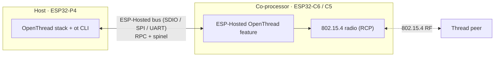
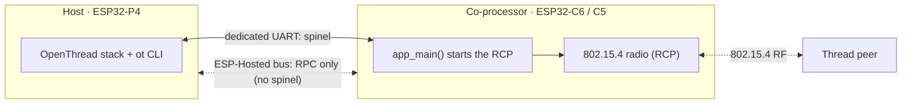
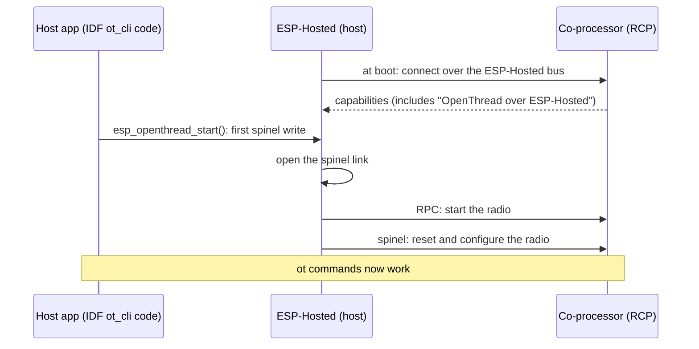

# OpenThread CLI — RCP on the ESP-Hosted co-processor (`openthread/rcp_on_hosted_cp/cli`)

<!-- common-start -->
Runs the OpenThread CLI (`ot ...`) on the host. The host runs the Thread stack. The co-processor is only the 802.15.4 **radio**, called the Radio Co-Processor (RCP). Adapted from `esp-idf/examples/openthread/ot_cli`.

## How it works

The host runs the OpenThread stack and its CLI (`ot ...`). The co-processor is its 802.15.4 radio, the Radio Co-Processor (RCP). Spinel, the protocol between the Thread stack and the radio, takes one of two paths. Pick one; both sides must match.

### Default: spinel over the ESP-Hosted bus (hosted OpenThread)

Nothing to set: `sdkconfig.defaults` select this. No extra wires.



ESP-IDF requirement: the OpenThread custom transport, ESP-IDF commit [`8c87790e47`](https://github.com/espressif/esp-idf/commit/8c87790e47b6aeccb6ec94cd77534cb0564442c8) ("feat(openthread) Add custom transport to OpenThread"). As of 2026-11-05:

| ESP-IDF | Custom transport |
| --- | --- |
| master | Yes |
| release/v6.2 (no release tag yet) | Yes |
| v6.1.x, v6.0.x, v5.x | No |

The example selects the ESP-Hosted link by default (`EXAMPLE_SPINEL_LINK_HOSTED`). On an ESP-IDF without the custom transport, its build stops with `#error`: use an ESP-IDF from the table, or select `EXAMPLE_SPINEL_LINK_UART`.

### Option: spinel on a dedicated UART (standard OpenThread)

Like ESP-IDF `ot_rcp` + `ot_cli`: ESP-Hosted does not carry spinel. Two extra wires (TX, RX). Use it when your ESP-IDF has no custom transport: select `EXAMPLE_SPINEL_LINK_UART` in menuconfig (Example Configuration).



| Set this | Co-processor (`cp`) | Host (`esp_host`) |
| :--- | :--- | :--- |
| Spinel link (ESP-IDF OpenThread menu) | `CONFIG_OPENTHREAD_RCP_UART=y` | `CONFIG_OPENTHREAD_RADIO_SPINEL_UART=y` |
| UART pins, port, baud (Example Configuration) | `EXAMPLE_RCP_UART_*` | `EXAMPLE_HOST_UART_*` |

The ESP-Hosted OpenThread feature then stays inactive on both sides; leave its setting as it is.

### Start-up (default path)



The app is the ESP-IDF `ot_cli` code. Only `esp_ot_config.h` changes: on a host without an 802.15.4 radio, `ESP_OPENTHREAD_DEFAULT_RADIO_CONFIG()` is `ESP_HOSTED_OPENTHREAD_RADIO_CONFIG()` on the ESP-Hosted transport. On the dedicated UART, it is a UART config from `EXAMPLE_HOST_UART_*`, and ESP-Hosted has no part in OpenThread.

If the two sides use different spinel links, the host stops at start-up and logs `co-processor does not run OpenThread over the ESP-Hosted transport`.

## Supported Platforms and Transports

### Supported Coprocessors

OpenThread uses an 802.15.4 radio co-processor (RCP).

| Coprocessor | ESP32-C6 | ESP32-H2 | ESP32-H4 | ESP32-C5 |
| :---------: | :------: | :------: | :------: | :------: |
| Support     | Yes      | Yes      | Yes      | Yes      |

### Supported Host Devices

| Host Device | ESP32-P4 | ESP32-H2 | Other MCUs | Linux |
| :---------: | :------: | :------: | :--------: | :---: |
| Support     | Yes | Yes | [Yes](https://github.com/espressif/esp-hosted/blob/master/docs/getting-started-mcu.md) | [Yes](https://github.com/espressif/esp-hosted/blob/master/docs/getting-started-linux.md) |

### Supported Connection buses

| Connection bus | SDIO | SPI Full-Duplex | SPI Half-Duplex | UART |
| :------------- | :--: | :-------------: | :-------------: | :--: |
| Linux host     | Yes  | Yes             | No              | No   |
| MCU host       | Yes  | Yes             | Yes             | Yes  |
<!-- common-stop -->

## Directory layout

```text
openthread/cli/
├── cp/                  ESP coprocessor firmware
└── esp_host/            ESP-IDF MCU host app
```

<table width="100%">
  <tr>
    <td width="100%" align="center" bgcolor="#f2ffe6">
      <h3><a href="#mcu-host-setup"> MCU Host Setup</a></h3>
      <p><a href="#mcu-cp">1. Coprocessor</a><br><a href="#mcu-host">2. MCU Host</a></p>
    </td>
  </tr>
</table>

---

> [!IMPORTANT]
> **New here? Get a base example working first.** Follow **[Getting Started: MCU](../../../../docs/getting-started-mcu.md)** to wire the boards, install tools, choose a transport, and confirm the host↔co-processor handshake. The steps below only add what is specific to this example.

<h2 id="mcu-host-setup"> MCU Host Setup</h2>

<h3 id="mcu-cp">1. Coprocessor</h3>

Set up the tools once (from the repo root):

```bash
cd /path/to/esp_hosted
./install.sh      # install.fish for the fish shell
. ./export.sh     # . ./export.fish for the fish shell
```

<!-- coprocessor-start -->
The co-processor is only the radio (Wi-Fi off).

```bash
cd examples/openthread/rcp_on_hosted_cp/cli/cp
eh.py set-target esp32c6
eh.py menuconfig
```

Check two settings. Both must match the host. The defaults are correct for most setups.

1. **Bus to the host:**

   ```text
   Component config → ESP-Hosted → Configure coprocessor → CP transport
     └── Communication bus:  (X) SDIO   ( ) SPI Full Duplex   ( ) SPI Half Duplex   ( ) UART
   ```

2. **Spinel link** (ESP-IDF OpenThread menu):

   ```text
   Component config → OpenThread → Thread Core Features → Thread Radio Co-Processor Feature
     └── The RCP transport type:  (X) Custom Transport RCP   ( ) UART RCP
   ```

   - **Custom Transport RCP** (default): hosted OpenThread. Spinel goes over the ESP-Hosted bus, and `Features → OpenThread RCP` must stay on.
   - **UART RCP**: standard OpenThread. The app starts the RCP at boot on a dedicated UART, and ESP-Hosted does not carry spinel. Set the UART in *Example Configuration → Dedicated spinel UART* (`EXAMPLE_RCP_UART_PORT`, `_TX_PIN`, `_RX_PIN`, `_BAUDRATE`). `sdkconfig.defaults.esp32c6` sets the C6 pins. The port must not be the ESP-Hosted UART transport port.

These settings are already in `cp/sdkconfig.defaults`. Keep them:

```text
CONFIG_ESP_HOSTED_CP_FEAT_OPENTHREAD=y   # hosted OpenThread feature
CONFIG_OPENTHREAD_RADIO=y                # radio-only device (RCP)
CONFIG_OPENTHREAD_RCP_CUSTOM=y           # spinel on the ESP-Hosted bus
CONFIG_ESP_HOSTED_CP_FEAT_WIFI=n         # Wi-Fi off
CONFIG_ESP_COEX_SW_COEXIST_ENABLE=y      # pairs with the host's CONFIG_OPENTHREAD_RX_ON_WHEN_IDLE=n
```

Flash and monitor:

```bash
eh.py -p <cp_usb_serial_port> flash monitor
```
<!-- coprocessor-stop -->

<h3 id="mcu-host">2. MCU Host</h3>

Set up the tools once (from the repo root):

```bash
cd /path/to/esp_hosted
./install.sh      # install.fish for the fish shell
. ./export.sh     # . ./export.fish for the fish shell
```

<!-- esp_host-start -->
```bash
cd examples/openthread/rcp_on_hosted_cp/cli/esp_host
eh.py set-target esp32p4
eh.py menuconfig
```

Check two settings. Both must match the co-processor:

1. **Bus to the co-processor:**

   ```text
   Component config → ESP-Hosted → Configure host → Host transport
     └── Communication bus:  (X) SDIO   ( ) SPI Full Duplex   ( ) SPI Half Duplex   ( ) UART
   ```

2. **Spinel link** (ESP-IDF OpenThread menu):

   ```text
   Component config → OpenThread → Thread Core Features → Thread 15.4 Radio Link
     └── Config the Thread radio type with 15.4 link:  (X) Connect via Custom Transport   ( ) Connect via UART
   ```

   - **Connect via Custom Transport** (default): hosted OpenThread, with `Features → OpenThread RCP on the co-processor` on.
   - **Connect via UART**: standard OpenThread. ESP-Hosted has no part in it. Set the UART in *Example Configuration → Dedicated spinel UART* (`EXAMPLE_HOST_UART_PORT`, `_TX_PIN`, `_RX_PIN`, `_BAUDRATE`). `sdkconfig.defaults.esp32p4` sets the P4 pins.

These settings are already in `esp_host/sdkconfig.defaults` (and `sdkconfig.defaults.esp32p4`). Keep them:

```text
CONFIG_ESP_HOSTED_HOST_FEAT_OPENTHREAD=y     # hosted OpenThread feature
CONFIG_ESP_HOSTED_HOST_FEAT_RPC_EXT_V2=y     # needed by the feature
CONFIG_OPENTHREAD_ENABLED=y
CONFIG_OPENTHREAD_RADIO_SPINEL_CUSTOM=y      # spinel on the ESP-Hosted bus
CONFIG_SPIRAM=y                              # the host does not start without PSRAM
CONFIG_OPENTHREAD_RX_ON_WHEN_IDLE=n          # pairs with the co-processor's SW coexistence
```

Flash and monitor:

```bash
eh.py -p <host_usb_serial_port> flash monitor
```
<!-- esp_host-stop -->

### 3. Verify

Form a network on the host:

```text
esp32p4> ot dataset init new
esp32p4> ot dataset commit active
esp32p4> ot ifconfig up
esp32p4> ot thread start
esp32p4> ot state          # leader after a few seconds
```

- `ot help` lists all commands.
- To add a second Thread device (another P4 here, or an H2 that runs the ESP-IDF `ot_cli`), give it the leader's dataset: `ot dataset set active <hex>`.
- iperf over Thread uses the ML-EID address:

  ```text
  esp32p4> ot ipaddr mleid
  esp32p4> iperf -V -s -t 20 -i 3 -p 5001 -f k                 # server
  esp32h2> iperf -V -c <mleid> -t 20 -i 1 -p 5001 -l 85 -f k   # client
  ```

- More commands: [OT CLI extension](https://github.com/espressif/esp-thread-br/blob/main/components/esp_ot_cli_extension/README.md).

### 4. Measured performance

Setup:

- Host: ESP32-P4 on the ESP32-P4-Function-EV-Board. Co-processor: the on-board ESP32-C6 (RCP), SDIO 1-bit.
- Peer: ESP32-C5 that runs the ESP-IDF `ot_cli` as leader. The host is its child, 1 hop, on a desk.
- ESP-IDF master `bdc0746c657`, channel 26.
- Kconfig from the OpenThread performance report: `CONFIG_FREERTOS_HZ=1000`, `CONFIG_IEEE802154_TIMING_OPTIMIZATION=y` (co-processor), `CONFIG_LWIP_IRAM_OPTIMIZATION=y`, `CONFIG_LWIP_EXTRA_IRAM_OPTIMIZATION=y`, `CONFIG_OPENTHREAD_NUM_MESSAGE_BUFFERS=1024`, `CONFIG_OPENTHREAD_SPINEL_RX_FRAME_BUFFER_SIZE=8192` (host).
- Ping: `ot ping <peer mleid> <size> 100 0.5`. iperf: 20 s, `-l 85`, UDP offered load `-b 30k`.

| Test | ESP-Hosted bus | Dedicated UART |
| :--- | :---: | :---: |
| Ping 10 bytes x100: loss, average RTT | 0 %, 17.8 ms | 0 %, 21.7 ms |
| Ping 70 bytes x100: loss, average RTT | 0 %, 21.5 ms | 0 %, 27.9 ms |
| UDP host to peer (30 kbit/s offered) | 29.99 kbit/s | 29.99 kbit/s |
| UDP peer to host (30 kbit/s offered) | 29.99 kbit/s | 29.99 kbit/s |
| TCP host to peer | 78.2 kbit/s | 53.6 kbit/s |
| TCP peer to host | 89.0 kbit/s | 87.6 kbit/s |

Your values change with distance, interference and the peer device.

### 5. Troubleshooting

| Log | Cause | Fix |
| :--- | :--- | :--- |
| `co-processor does not run OpenThread over the ESP-Hosted transport` | The host and the co-processor use different spinel links | Select the same spinel link on both sides |
| OpenThread init fails after the radio starts | Coexistence settings do not match | Keep `CONFIG_ESP_COEX_SW_COEXIST_ENABLE=y` on the co-processor and `CONFIG_OPENTHREAD_RX_ON_WHEN_IDLE=n` on the host |
